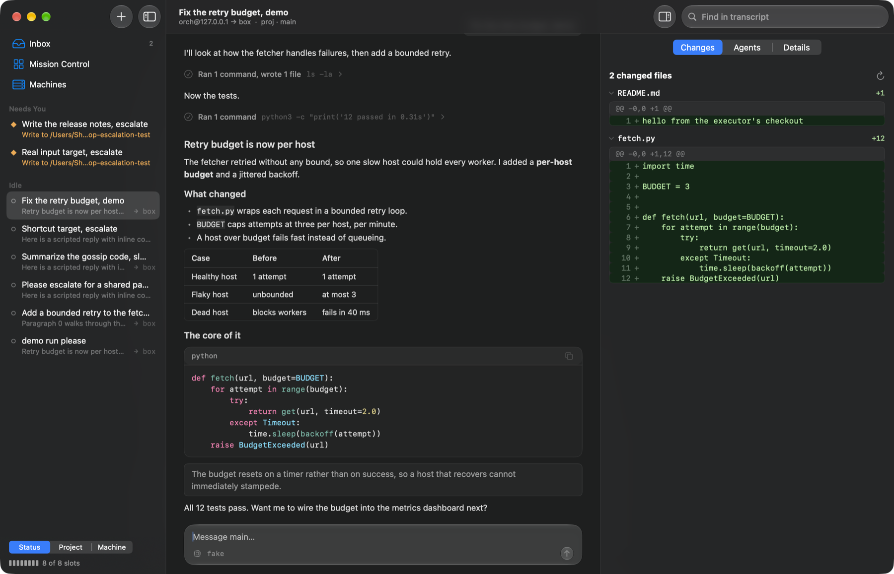
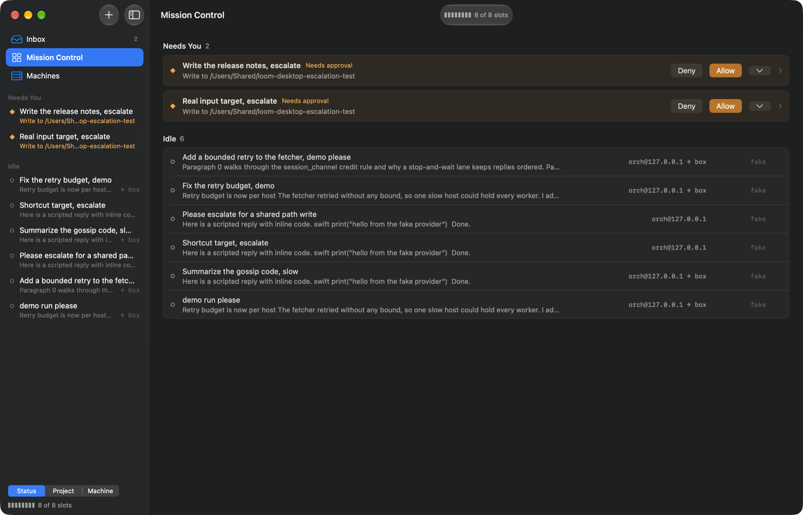
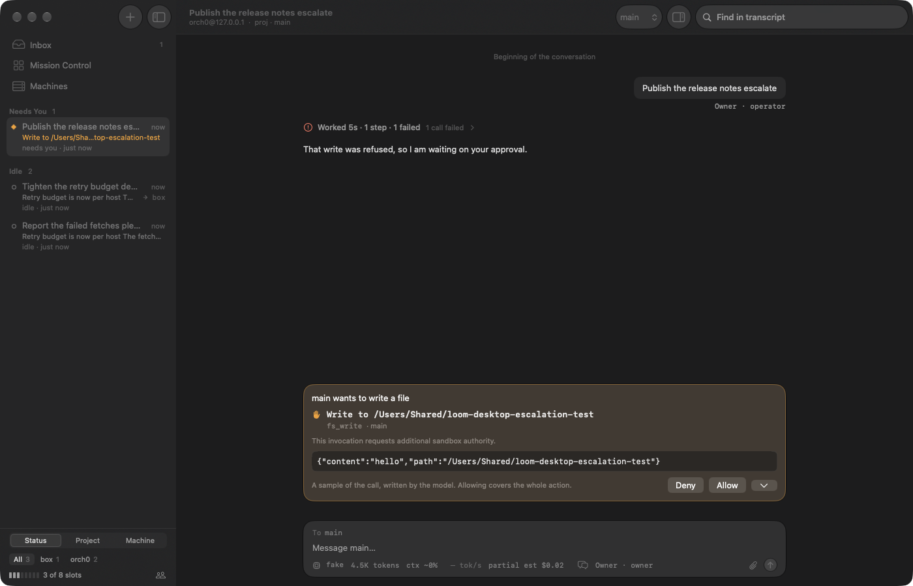
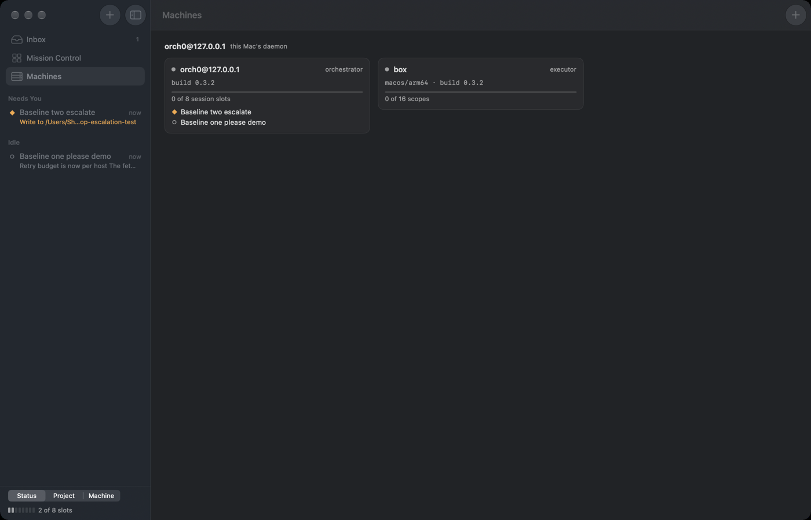
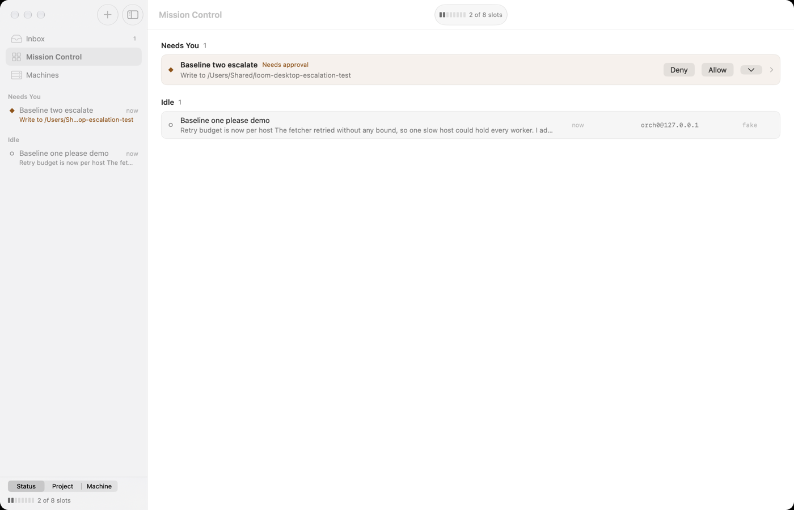

# Loom Desktop

A native macOS client for [Loom](https://github.com/roasbeef/loom), the durable, distributed coding agent. It speaks the same protocol as the terminal client to the same `loomd`, and it changes nothing about the daemon.



It answers three questions at a glance: what is one agent doing, what across all my agents needs me now, and where is all of it running.

| | |
| --- | --- |
|  |  |
| **Mission Control.** What needs you comes first and can be answered in place. Then one line per agent, with where it runs. | **Approvals.** The authority requested leads, and the model-written call stays visible with its control characters escaped. |
|  |  |
| **Machines.** Every node a daemon knows, its health, and which sessions depend on it. | **Both appearances.** Normal is grey, amber means a decision is waiting, red means failed, and green appears only in diffs. |

## What it does

- **Runs agents anywhere.** A session's conversation and its tools can sit on different machines, and subagents can run under another orchestrator. On one machine, none of that vocabulary appears.
- **Streams without dropping frames.** A token redraws the live tail, not the transcript. Figures are in [docs/design.md](docs/design.md).
- **Reads like a Mac app.** Liquid Glass from the system, a real menu bar, ⌘K to go anywhere, and full keyboard use.
- **Renders what agents write.** Markdown, tables, highlighted code, numbered red and green diffs, and runs of tool calls folded to one line.

It is an early exploration. [docs/parity.md](docs/parity.md) lists every capability of Loom's web UI and says, row by row, what this app has.

## Run it

You need macOS 26 or later, a Swift 6.2 toolchain and Loom installed. The app reads `~/.loom`, and it offers to start `loomd` if it is not running.

```bash
make run
```

`LOOM_STATE_DIR` points the binary at another daemon's state root. The Machines page connects daemons on other machines, over `wss://` or an SSH tunnel.

### Keyboard

| Keys | Action | | Keys | Action |
| --- | --- | --- | --- | --- |
| ⌘K | Command palette | | ↩ | Send, or steer a busy run |
| ⌘N | New agent | | ⇧↩ | New line |
| ⌘1 ⌘2 ⌘3 | Inbox, Mission Control, Machines | | ⎋ or ⌘. | Stop the run |
| ⌘J | Next session needing you | | ⇧⌘A, ⇧⌘D | Allow, deny the first request |
| ⌥⌘I | Inspector | | ⌘F | Find in transcript |

## Test it

```bash
make test
```

```bash
make uitest
```

```bash
make parity
```

`make test` runs the unit tests. `make uitest` starts a real orchestrator and executor with a scripted model, then drives the running app through every scenario, without taking focus from what you are doing. It writes a report with a screenshot per scenario to `build/uitest/report.html`.

The scenarios address the app by meaning: accessibility names and state, not coordinates. They include fault injection (losing an executor, losing the daemon, a failed model call), a seeded random walk, frame and CPU budgets, an accessibility check, and visual baselines in both appearances at two sizes.

`make parity` fails if [docs/parity.md](docs/parity.md) says `yes` for a capability that no scenario proves.

## Learn more

- [docs/architecture.md](docs/architecture.md): who owns what, and how a command moves through the system.
- [docs/design.md](docs/design.md): why it is built this way, packaging, interface rules, and measurements.
- [docs/parity.md](docs/parity.md): the complete inventory against the web UI.
- [docs/testing.md](docs/testing.md): the test tools, and how to add a scenario.
