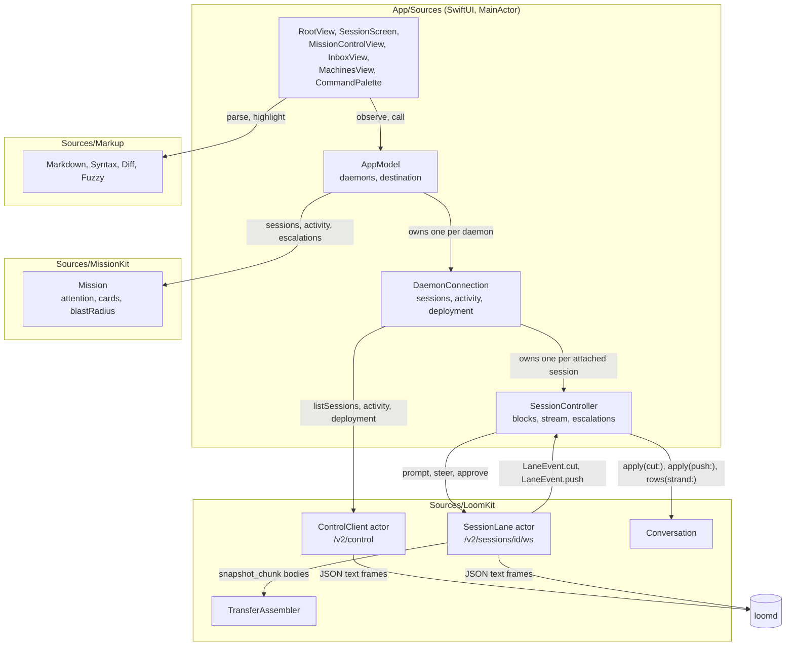
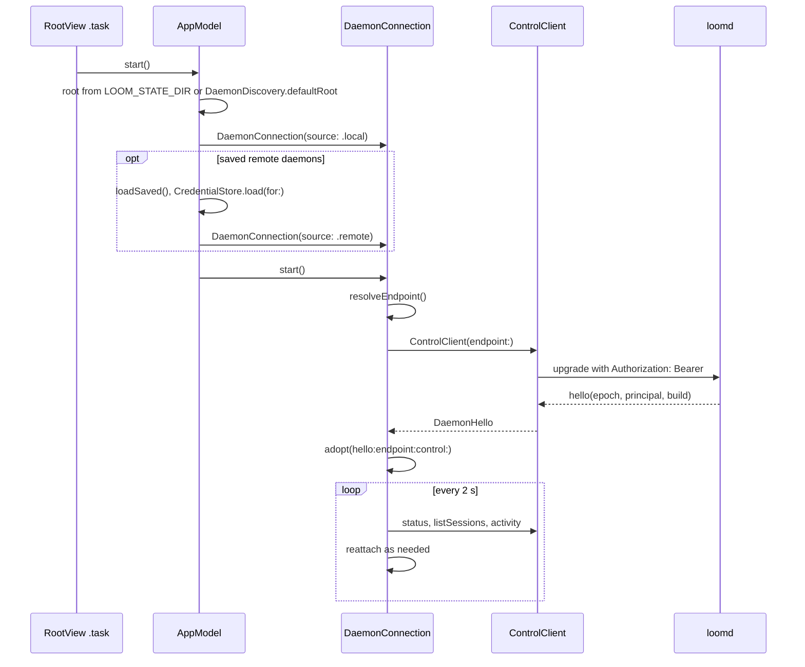
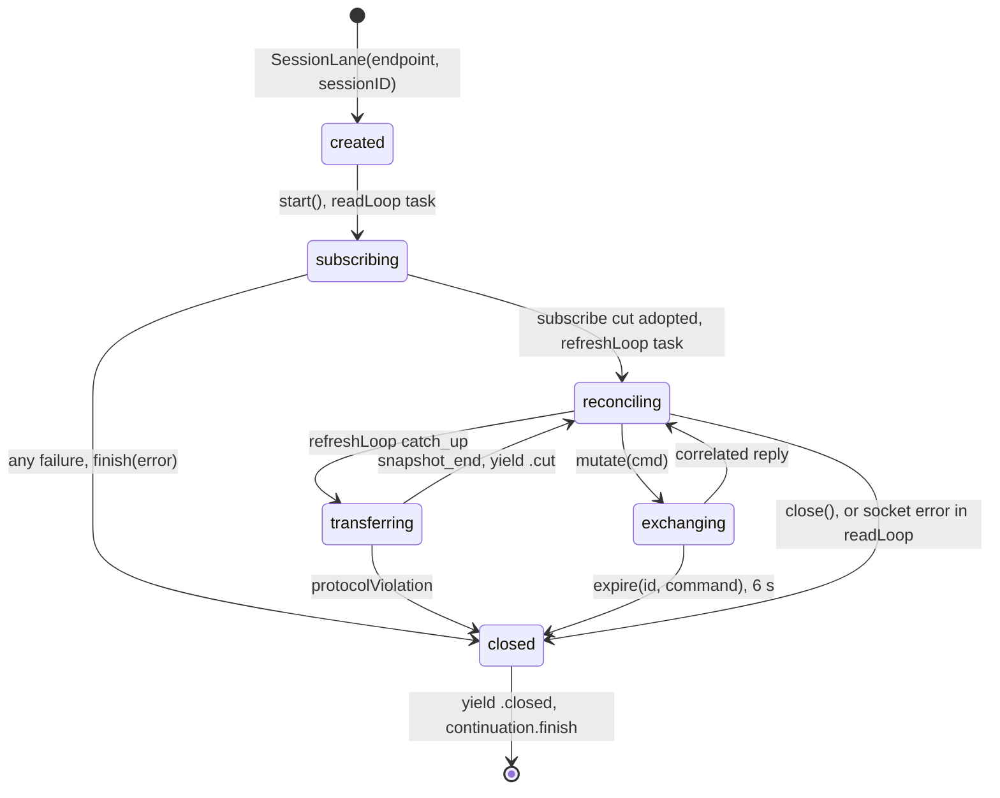
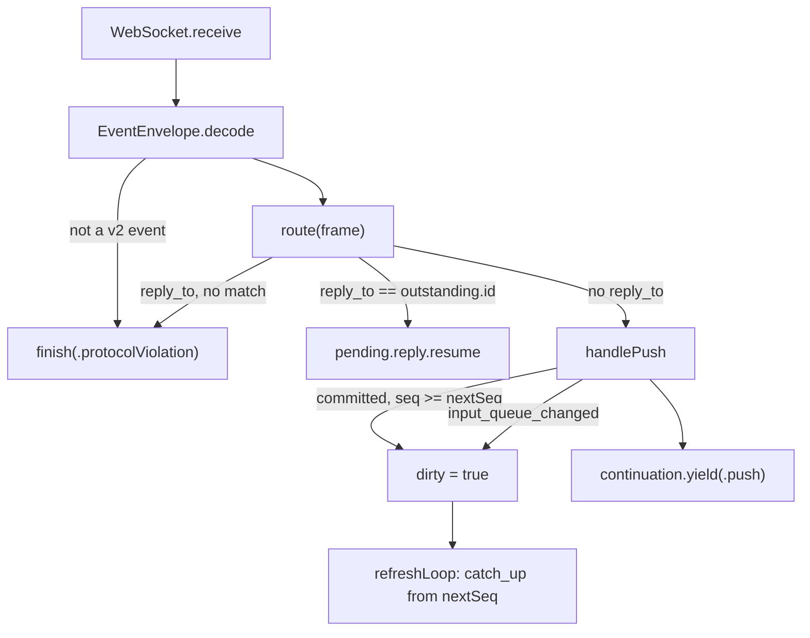
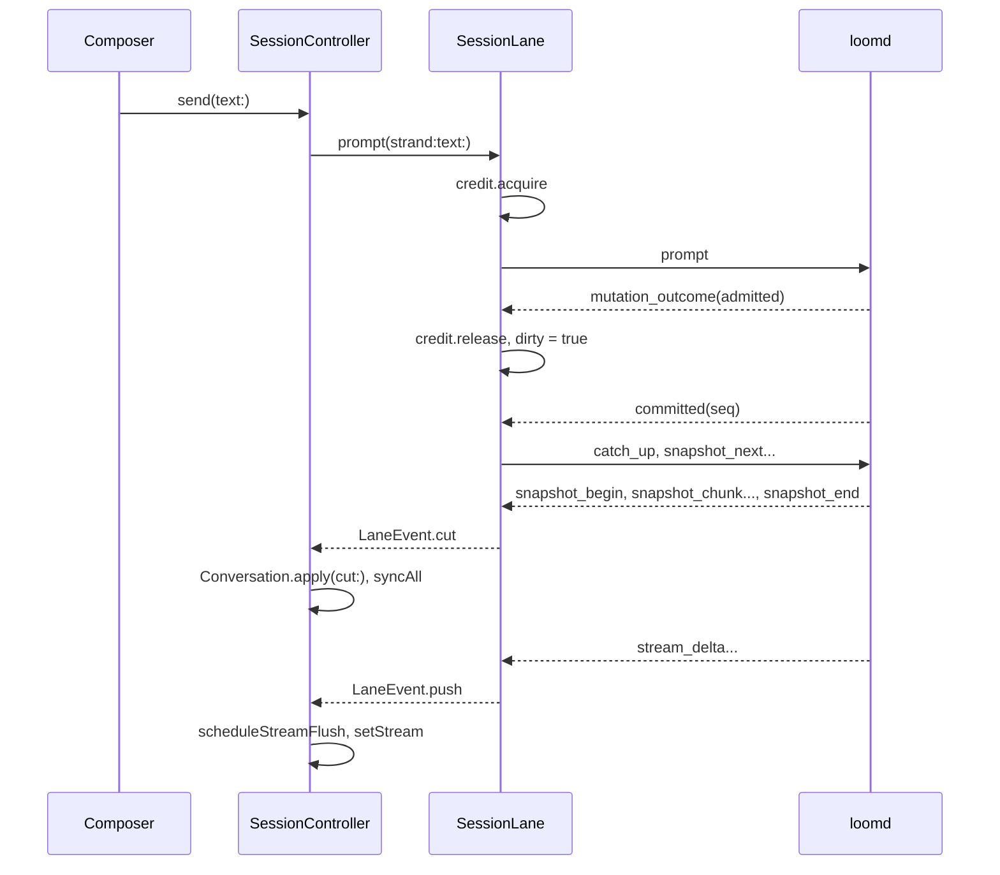
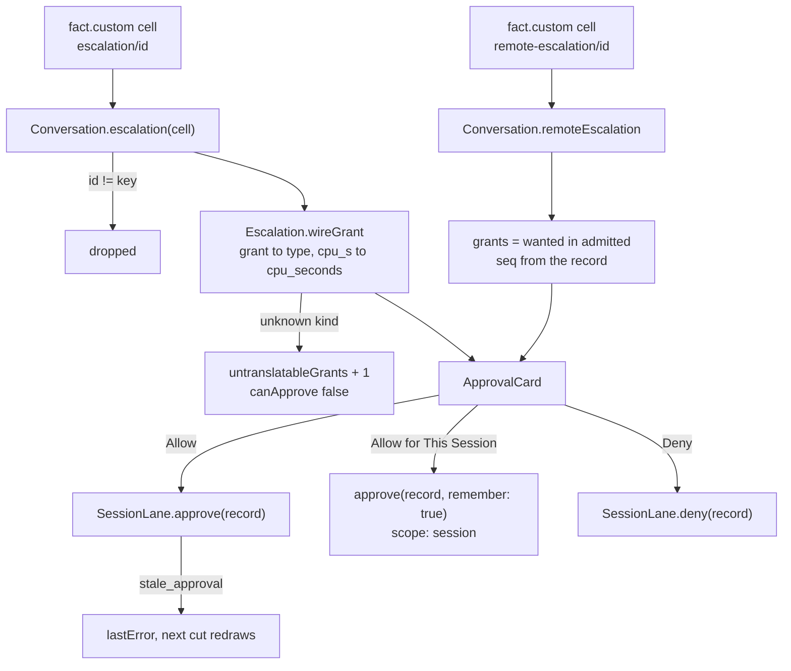
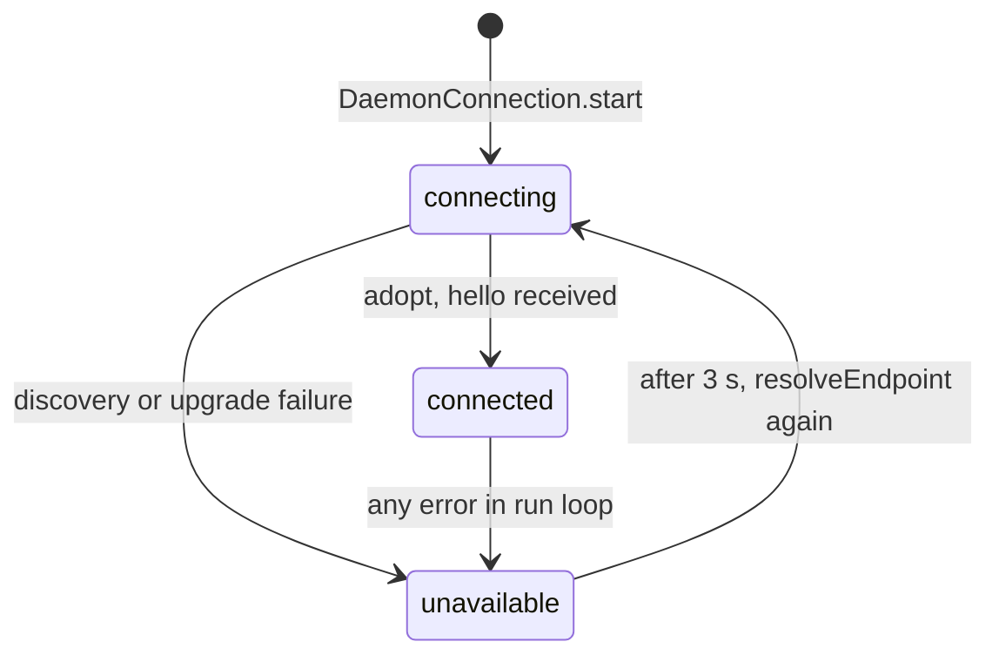

# Loom Desktop Architecture

Loom Desktop keeps a native window in step with one or more `loomd` daemons, through the daemon's v2 WebSocket protocol and nothing else. This document describes which type owns which state, which thread of execution touches it, and how a command moves from a person's input to a durable record that returns as a transcript row. It reflects the code at commit `0fd865c`, plus the test tools described under Testing.

For the reasons behind these choices, the interface rules and the packaging plan, see [design.md](design.md). For what the wire promises, see Loom's `docs/client-protocol.md`, cited below as "protocol section N".

## Components

The code divides into three libraries with no UI dependency and one SwiftUI target. Decisions live in pure values in the libraries, and `App/Sources` owns the sockets' lifetimes, the timers and the views. The diagram shows what crosses each boundary.

The table states each type's responsibility and its limit. The "does not own" column is the part a reader cannot get from the code's declarations.

| Type | File | Owns | Does not own |
| --- | --- | --- | --- |
| `AppModel` | `App/Sources/AppModel.swift` | The list of `DaemonConnection`s, `destination`, saved remote daemons, `seenReplies` | Any socket. It merges what connections report. |
| `DaemonConnection` | `App/Sources/AppModel.swift` | One `ControlClient`, one daemon's catalogue, activity, `Deployment`, `attached` controllers, `lastChanged` | Conversation state, which each `SessionController` holds. |
| `SessionController` | `App/Sources/AppModel.swift` | One `SessionLane`, one `Conversation`, and the observed properties views read | Protocol order. `SessionLane` enforces it. |
| `ControlClient` | `Sources/LoomKit/ControlClient.swift` | The control socket, `hello`, correlation ids | Polling, which `DaemonConnection` schedules. |
| `SessionLane` | `Sources/LoomKit/SessionLane.swift` | The session socket, the credit, `nextSeq`, the reconcile cadence | The meaning of a cut. It delivers cuts whole. |
| `TransferAssembler` | `Sources/LoomKit/Transfer.swift` | One transfer's fragments and their validation | The socket, and anything after `finish`. |
| `Conversation` | `Sources/LoomKit/Conversation.swift` | Entries by id, the latest metadata projection, live streams, `revision` | Any I/O. It is a value. |
| `Escalation` | `Sources/LoomKit/Escalation.swift` | One pending request, its wire-form `grants`, preview escaping | The decision. A view passes the displayed record to `approve`. |
| `Mission` | `Sources/MissionKit/Attention.swift` | The merge rules for `AttentionItem`, `AgentCard` and `Placement` | Fetching. It is a set of pure functions. |
| `Markdown`, `Syntax`, `Diff`, `Fuzzy` | `Sources/Markup/` | Text to structure | Colour and layout, which `Theme.swift` applies. |
| `DebugDriver` | `App/Sources/DebugDriver.swift` | Test commands, captures, frame and accessibility instruments | Anything in a release build. It compiles only under `DEBUG`. |

## Startup

The app connects to every known daemon at launch and attaches to no session until something needs one. `AppModel.start` runs from the first window's `.task`, so a window exists to draw connection state before any socket opens.

`DaemonDiscovery.discover` reads `daemon.endpoint` and `owner.token` under the state root, and it accepts only a 64-character hexadecimal token. A local record proves nothing about liveness: only the authenticated `hello` does. `DaemonEndpoint.url(path:)` refuses `ws://` to any non-loopback host, and `DaemonEndpoint(address:token:)` refuses a value with the `loomclaim_` prefix.

When the first connection fails before any `hello`, `AppModel.isDaemonMissing` is true and `RootView` draws `DaemonMissingView`. Its button calls `AppModel.startDaemon`, which runs `loom sessions list`, so the terminal client's launch procedure performs the start.

## The session lane

A lane is one attachment to one resident session. All session traffic passes through it, and it enforces the two ordering rules of protocol sections 4.2 and 6.6: at most one command in flight, and at most one transfer open. A transfer takes many exchanges, so `CreditLock` is held across all of them, and a prompt typed during a transfer waits in the lock's first-in, first-out queue.

The state diagram shows the lane's lifetime. `closed` is the only terminal state and every failure path reaches it through `finish`.

Three rules sit outside the diagram.

- A `.server` error on a `catch_up` or a mutation leaves the lane open, because a refusal says nothing about the socket. The exception is the first `subscribe`, where any failure ends the lane, since a lane with no first cut has nothing to reconcile from.
- `expire` ends the lane only if the timed-out id is still `outstanding`, so a reply arriving at the deadline cannot close a healthy lane.
- A lost reply is never resent (protocol section 6.5). A closed lane resumes the waiting continuation with an error, and the person decides what to do.

### A frame's route

`SessionLane.readLoop` is the only reader of the socket. A frame with `reply_to` must match `outstanding`, and any other value is a protocol violation that ends the lane. A frame without `reply_to` is a push, which may arrive in any phase, including inside a transfer.

The reconcile cadence is what makes a lost notice harmless. `refreshLoop` wakes every 100 ms and issues `catch_up` when `dirty` is set or when `refreshInterval` has elapsed. The interval starts at `idleRefresh` (1 s), doubles after each cut with no entries up to `restingRefresh` (5 s), and returns to 1 s at any notice or delta. A `history` or `lineage` cut does not advance `nextSeq`, or the live tail would be skipped.

### Transfer assembly

`TransferAssembler` validates a transfer against protocol section 4.3 and exposes a `Cut` only from `finish`, which is what keeps a partial transfer away from every view.

1. **Begin.** `init(begin:expectedSession:expectedIdentity:)` checks the session id, that `complete_history` is false, the limits (`recordLimit` 33,554,432 bytes, `fragmentLimit` 24,576 bytes), and that the identity matches any earlier transfer on the socket.
2. **Absorb.** `absorb(chunk:)` checks the transfer id, the index and the offset, refuses an entry before metadata is complete, and refuses interleaved records.
3. **Complete a record.** Metadata and entries parse to `JSONValue`. An entry above `presentationLimit` (4,194,304 bytes) is drained and kept as an `oversized` placeholder, marked `unknownParent` because its parent was not decoded.
4. **Finish.** `finish(end:)` checks `next_seq` against the header and that no record is partial, and it returns the `Cut`.

## From a keystroke to a transcript row

A prompt becomes visible only when its durable entry returns through a cut. Nothing is drawn optimistically, so the transcript never shows text the daemon did not record. The sequence is the path for a prompt on an idle strand.

The main thread stays free because `SessionController` narrows what each event invalidates. `Conversation` is held outside observation, and each fact a view draws is its own observed property, assigned only when it changes.

- **A delta** updates only `stream`, coalesced by `scheduleStreamFlush` to 33 ms, or 60 ms above 4,000 bytes of text, or 100 ms above 16,000.
- **An identical cut** returns false from `Conversation.apply(cut:)`, after comparing metadata with `lastMetadata`, and costs no redraw.
- **A changed cut** bumps `Conversation.revision`, and only then does `syncAll` rebuild `blocks` through `rows(strand:)` and `TranscriptBlock.group`.

`Conversation.rows(strand:)` walks `parentId` from the strand's `strand.leaf` cell rather than sorting by sequence, which keeps other strands and abandoned branches out. The walk stops at the first entry not held, and `hasOlder(strand:)` reports that case. An ended stream stays drawn until an entry lands, so a reply does not vanish between `end` and its cut.

## Approvals

An approval echoes exactly what was displayed, because the daemon compares the echo to the record. The escalation reaches the client as a register cell, in the durable vocabulary, and the wire command needs the protocol's vocabulary.

The local `expected_seq` is the cell's register sequence, while a remote record's is its own `seq`, the other orchestrator's. `Escalation.safePreview` escapes control and bidirectional characters instead of deleting them (protocol section 5.10). `canRemember` admits only `writable_root`, `readable_root` and full `network` grants, and a mixed request stays once-only, matching `session_view/approval.rememberable`.

A count in `sessions.activity` says only that a record exists, so `DaemonConnection.refresh` attaches a lane to any session reporting `approvals > 0`. `AppModel.attention` ignores escalations from a dead lane and falls back to the count, because those records may be stale and cannot be answered.

## Machines

A session's brain is the daemon holding it, and its hands are where tools run. `Placement` computes both from a catalogue record and the holding connection's label. `AppModel.isMultiMachine` hides all of this vocabulary when only one machine exists.

| Fact | Source | Read by |
| --- | --- | --- |
| Hands | `executor`, `pool` on `SessionRecord` | `Placement.init(record:brain:)` |
| Nodes and health | `deployment.status` | `DaemonConnection.refreshDeployment`, every 8th refresh |
| Placement options | `placements` in `deployment.status` | `DispatchSheet` |
| An executor's workspaces | `deployment.status` with `node` | `DaemonConnection.workspaces(onExecutor:)` |
| Other orchestrators' sessions | `sessions.elsewhere` | `MachinesView`, `ElsewhereSection` |
| Subagents elsewhere | `remote_children` snapshot push | `Conversation.apply(push:)`, `RemoteAgentsStrip` |
| A remote child's transcript | `child_history` | `SessionController.peek(child:)`, `ChildPeekSheet` |

`Mission.blastRadius` joins unhealthy nodes with the sessions naming them. `Mission.attention` adds an item only when a sick node has dependents. Driving a session on another orchestrator takes a `DaemonConnection` to that orchestrator with its own credential, which `CredentialStore` keeps in the keychain.

## Reconnection

Sockets drop independently, and each has its own recovery. The rule is that nothing unsent crosses a reconnect (protocol section 6.7).

On `adopt`, a changed epoch detaches every controller, since every ephemeral fact is void. The same epoch keeps them, because session sockets are independent of the control socket. Separately, each `refresh` reattaches any controller that is not live while its session is resident, copying `focusedStrand` to the replacement. Its transcript reloads from a fresh `subscribe`.

## Storage

The app keeps no conversation data: the daemon's stores are the only record, and every view is rebuilt from the wire. What persists locally is small and listed here.

| Data | Location | Written by |
| --- | --- | --- |
| Remote daemon names and addresses | `UserDefaults` key `savedDaemons` | `AppModel.addDaemon` |
| Remote credentials | Login keychain, service `com.roasbeef.loom-desktop.daemon` | `CredentialStore.save` |
| Last reply seen per session | `UserDefaults` key `seenReplies` | `AppModel.markSeen`, `recordFirstReplies` |
| View preferences | `AppStorage`, `SceneStorage` | Views |

## Concurrency

Three kinds of execution context exist, and each mutable state has exactly one owner.

| Context | Owns | Reached by |
| --- | --- | --- |
| Main actor | `AppModel`, `DaemonConnection`, `SessionController`, `HighlightCache`, `MarkdownView.inlineCache` | SwiftUI and tasks they start |
| `ControlClient` actor | Control socket order, `nextID`, `hello` | `await` from `DaemonConnection` |
| `SessionLane` actor | `outstanding`, `nextSeq`, `dirty`, `identity`, `refreshInterval` | `await`, its `readLoop` and `refreshLoop` tasks |
| `CreditLock` actor | The waiter queue | `SessionLane`, `ControlClient` |

These rules make that table safe.

- An actor releases its isolation at each `await`, so `CreditLock` holds stop-and-wait order across a whole transfer. The actor alone does not.
- `ControlClient.exchange` closes its socket on any failure. A late reply would otherwise be read as the answer to the next command.
- A timeout does not mean a command failed. `LoomError.outcomeUnknown` means the daemon may have applied it, and the lane reconciles rather than retries. Only `sessions.create` is safe to repeat, under its durable `requestKey`, which `DispatchSheet` holds across attempts.
- `LaneEvent`s are delivered through an unbounded `AsyncStream`, and `SessionController.run` is its only consumer.

## Testing

`DebugDriver` and `AccessibilityAudit` give tests a view of the running app, and `tests/ui/` holds the scenarios that use them. [testing.md](testing.md) describes the layers.

## Known gaps

- Remote subagents, remote escalations and `wss://` connections have unit tests only. No run has exercised them against a second orchestrator.
- A window other than the main one has no Session menu of its own: `AppModel.currentSession` follows `destination`.
- The document does not cover view layout, which `design.md` describes as rules.
- The frame and CPU figures in `design.md` depend on the machine they were taken on.
