# Loom Desktop Architecture

Loom Desktop keeps a native window in step with one or more `loomd` daemons, through the daemon's v2 WebSocket protocol and nothing else. This document describes which type owns which state, which thread of execution touches it, and how a command moves from a person's input to a durable record that returns as a transcript row. It reflects the code at commit `874b12b`, including the test tools described under Testing.

For the reasons behind these choices, the interface rules and the packaging plan, see [design.md](design.md). For what the wire promises, see Loom's `docs/client-protocol.md`, cited below as "protocol section N". For which capabilities of the web UI exist here, see [parity.md](parity.md).

## Components

The code divides into four libraries with no UI dependency and one SwiftUI target. Decisions live in pure values in the libraries, and `App/Sources` owns the sockets' lifetimes, the timers and the views. The diagram shows what crosses each boundary.

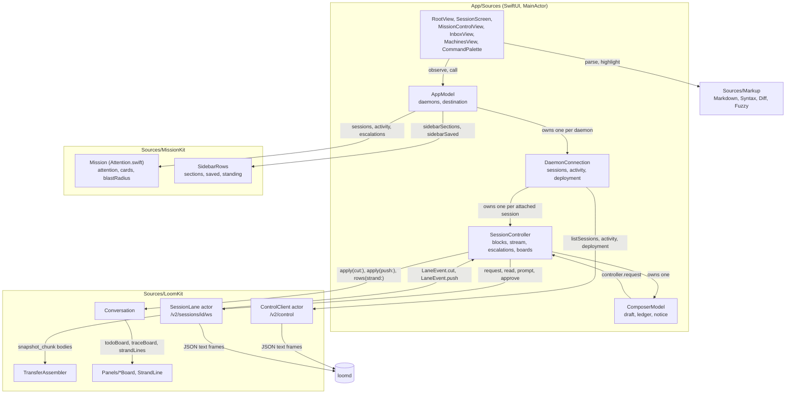

The table states each type's responsibility and its limit. The "does not own" column is the part a reader cannot get from the code's declarations.

| Type | File | Owns | Does not own |
| --- | --- | --- | --- |
| `AppModel` | `App/Sources/AppModel.swift` | The list of `DaemonConnection`s, `destination`, saved remote daemons, `seenReplies`, `SessionActions` | Any socket. It merges what connections report. |
| `DaemonConnection` | `App/Sources/AppModel.swift` | One `ControlClient`, one daemon's catalogue, activity, `Deployment`, `attached` controllers, `lastChanged` | Conversation state, which each `SessionController` holds. |
| `SessionController` | `App/Sources/AppModel.swift` | One `SessionLane`, one `Conversation`, one `ComposerModel`, and the observed properties views read | Protocol order. `SessionLane` enforces it. |
| `ComposerModel` | `App/Sources/ComposerModel.swift` | The draft, attached images, the `DraftLedger`, the notice, an edit of a held input | Parsing a draft, which `SlashCommand.parse` does, and the socket. |
| `SlashCommand` | `Sources/LoomKit/SlashCommand.swift` | What a draft means, the command list, completions | Carrying a command out. `ComposerModel.execute` does. |
| `ControlClient` | `Sources/LoomKit/ControlClient.swift` | The control socket, `hello`, correlation ids | Polling, which `DaemonConnection` schedules. |
| `SessionLane` | `Sources/LoomKit/SessionLane.swift` | The session socket, the credit, `nextSeq`, the reconcile cadence | The meaning of a cut. It delivers cuts whole. |
| `TransferAssembler` | `Sources/LoomKit/Transfer.swift` | One transfer's fragments and their validation | The socket, and anything after `finish`. |
| `Conversation` | `Sources/LoomKit/Conversation.swift` | Entries by id, the latest metadata projection, live streams, decided approvals, snapshot surfaces, `revision` | Any I/O. It is a value. |
| `TranscriptBlock`, `Fold`, `StepWords` | `Sources/LoomKit/Turns.swift` | Cutting rows into turns, a fold's figures, a step's verb and subject | Layout. `FoldView` draws them. |
| `ProgramCard`, `ImageBlock` | `Sources/LoomKit/ProgramCard.swift`, `ImageBlock.swift` | A `code_mode` call as one card, an image a record carried and whether its bytes match its declared type | Drawing, which `ProgramCardView` and `PictureStrip` do. |
| `*Board`, `StrandLine`, `*Words` | `Sources/LoomKit/Panels/` | One decoder per observation, total, with the words a panel prints | Fetching. `SessionController` decides when to ask. |
| `Escalation` | `Sources/LoomKit/Escalation.swift` | One pending request, its wire-form `grants`, preview escaping | The decision. A view passes the displayed record to `approve`. |
| `Mission` | `Sources/MissionKit/Attention.swift` | The merge rules for `AttentionItem`, `AgentCard` and `Placement` | Fetching. It is a set of pure functions. |
| `SidebarRows` | `Sources/MissionKit/SidebarRows.swift` | The sidebar's rows, sections, standing words and grouping | Which machine a session runs on. `AppModel.machine(of:)` supplies it. |
| `Markdown`, `Syntax`, `Diff`, `Fuzzy` | `Sources/Markup/` | Text to structure | Colour and layout, which `Theme.swift` applies. |
| `DebugDriver` | `App/Sources/DebugDriver.swift` | Test commands, captures, frame and accessibility instruments | Anything in a release build. It compiles only under `DEBUG`. |

## Startup

The app connects to every known daemon at launch and attaches to no session until something needs one. `AppModel.start` runs from the first window's `.task`, so a window exists to draw connection state before any socket opens.

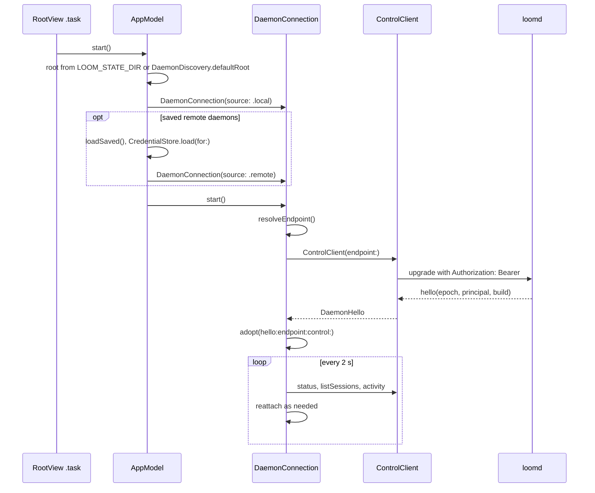

`DaemonDiscovery.discover` reads `daemon.endpoint` and `owner.token` under the state root, and it accepts only a 64-character hexadecimal token. A local record proves nothing about liveness: only the authenticated `hello` does. `DaemonEndpoint.url(path:)` refuses `ws://` to any non-loopback host, and `DaemonEndpoint(address:token:)` refuses a value with the `loomclaim_` prefix.

When the first connection fails before any `hello`, `AppModel.isDaemonMissing` is true and `RootView` draws `DaemonMissingView`. Its button calls `AppModel.startDaemon`, which runs `loom sessions list`, so the terminal client's launch procedure performs the start.

## The session lane

A lane is one attachment to one resident session. All session traffic passes through it, and it enforces the two ordering rules of protocol sections 4.2 and 6.6: at most one command in flight, and at most one transfer open. A transfer takes many exchanges, so `CreditLock` is held across all of them, and a prompt typed during a transfer waits in the lock's first-in, first-out queue.

The state diagram shows the lane's lifetime. `closed` is the only terminal state and every failure path reaches it through `finish`.

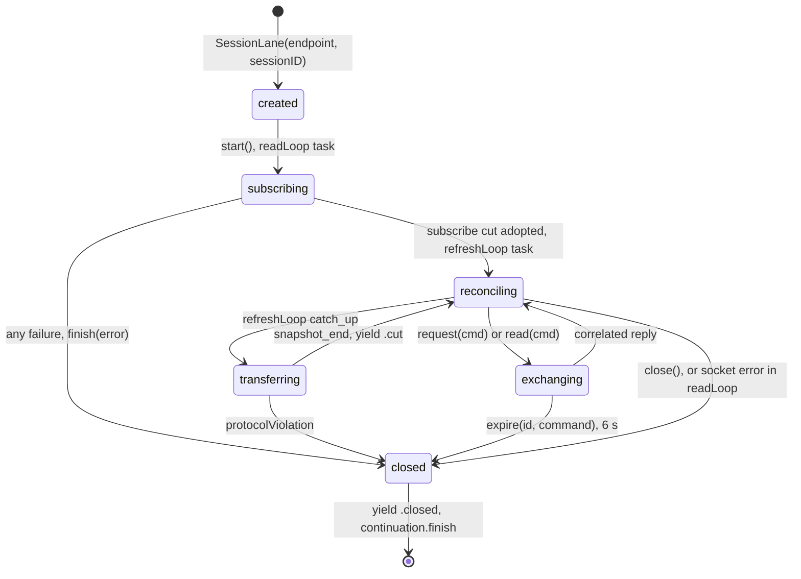

Three rules sit outside the diagram.

- A `.server` error on a `catch_up` or a command leaves the lane open, because a refusal says nothing about the socket. The exception is the first `subscribe`, where any failure ends the lane, since a lane with no first cut has nothing to reconcile from.
- `expire` ends the lane only if the timed-out id is still `outstanding`, so a reply arriving at the deadline cannot close a healthy lane.
- A lost reply is never resent (protocol section 6.5). A closed lane resumes the waiting continuation with an error, and the person decides what to do.

### Commands: request versus read

Every command that is not part of a transfer passes through one of two entry points, and the difference between them is whether the lane reconciles afterwards. `SessionLane.request` sets `dirty` once the reply arrives, so the next `refreshLoop` tick issues a `catch_up` and the committed record reaches the transcript within a tick. `SessionLane.read` takes the same credit and the same reply deadline, and leaves `dirty` alone, because a command that changes nothing has nothing to reconcile.

The distinction matters to the panels that poll. A panel reading `live_jobs` every 5 seconds through `read` costs one command each time. Through `request` it would also cost a `catch_up` transfer each time.

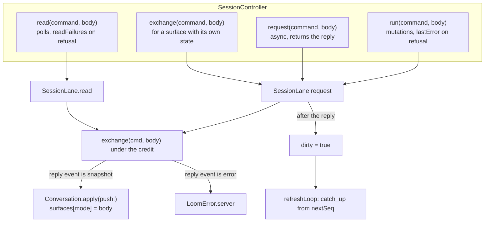

A reply whose event is `snapshot` is applied as a push is, so a command's answer and the daemon's own announcement of a change land in the same place: `Conversation.surfaces`, keyed by the snapshot's `mode`. `SessionLane.prompt`, `steer`, `abort`, `approve` and `deny` keep their own methods and go through `mutate`, which calls `request`.

### A frame's route

`SessionLane.readLoop` is the only reader of the socket. A frame with `reply_to` must match `outstanding`, and any other value is a protocol violation that ends the lane. A frame without `reply_to` is a push, which may arrive in any phase, including inside a transfer.

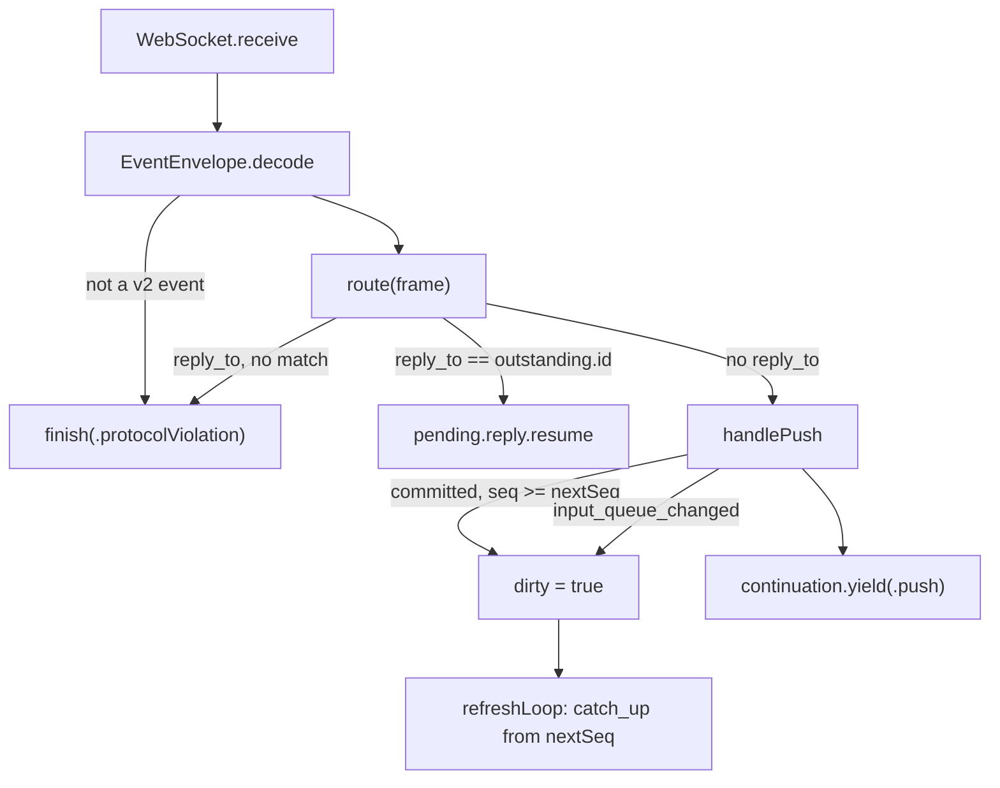

The reconcile cadence is what makes a lost notice harmless. `refreshLoop` wakes every 100 ms and issues `catch_up` when `dirty` is set or when `refreshInterval` has elapsed. The interval starts at `idleRefresh` (1 s), doubles after each cut with no entries up to `restingRefresh` (5 s), and returns to 1 s at any notice or delta.

### Transfers and windows

A transfer is one `snapshot_begin`, a series of `snapshot_chunk` frames fetched with `snapshot_next`, and a `snapshot_end`. `SessionLane.transfer` runs it under the credit and yields the resulting `Cut` as a `LaneEvent.cut`. Five commands start one, and the cut's `window` says which.

| Command | Method | Window | Moves `nextSeq` |
| --- | --- | --- | --- |
| `subscribe` | `start` | the live window | yes |
| `catch_up` | `refreshLoop` | the live window from `nextSeq` | yes |
| `history` | `loadOlder(beforeSeq:span:)` | `history` | no |
| `history_lineage` | `lineage(from:)` | `lineage` | no |
| `escalations_decided` | `decided()` | `decided` | no |

A window that pages backward or reads another set of cells does not advance `nextSeq`, or the live tail would be skipped. `Conversation.apply(cut:)` treats the windows differently as well: a `decided` cut only updates the decision ledger, and a `history` or `lineage` cut adds entries without replacing the metadata projection of the newer live cut.

`TransferAssembler` validates a transfer against protocol section 4.3 and exposes a `Cut` only from `finish`, which keeps a partial transfer away from every view.

1. **Begin.** `init(begin:expectedSession:expectedIdentity:)` checks the session id, that `complete_history` is false, the limits (`recordLimit` 33,554,432 bytes, `fragmentLimit` 24,576 bytes), and that the identity matches any earlier transfer on the socket.
2. **Absorb.** `absorb(chunk:)` checks the transfer id, the index and the offset, refuses an entry before metadata is complete, and refuses interleaved records.
3. **Complete a record.** Metadata and entries parse to `JSONValue`. An entry above `presentationLimit` (4,194,304 bytes) is drained and kept as an `oversized` placeholder, marked `unknownParent` because its parent was not decoded.
4. **Finish.** `finish(end:)` checks `next_seq` against the header and that no record is partial, and it returns the `Cut`.

## From a keystroke to a transcript row

A prompt becomes visible in the transcript only when its durable entry returns through a cut. The composer draws a pending line above the editor from the moment of the press, so the press is acknowledged, and the transcript still shows only what the daemon recorded. The sequence is the path for a plain prompt on an idle strand.

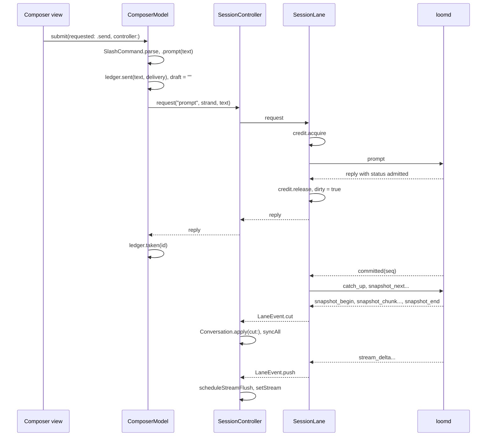

The main thread stays free because `SessionController` narrows what each event invalidates. `Conversation` is held outside observation, and each fact a view draws is its own observed property, assigned through `assign` only when it changes.

- **A delta** updates only `stream`, coalesced by `scheduleStreamFlush` to 33 ms, or 60 ms above 4,000 bytes of text, or 100 ms above 16,000.
- **An identical cut** returns false from `Conversation.apply(cut:)`, after comparing metadata with `lastMetadata`, and costs no redraw.
- **A changed cut** bumps `Conversation.revision`, and only then does `syncAll` rebuild `blocks` through `rows(strand:)` and `TranscriptBlock.group`.
- **A pushed snapshot** goes through `syncPushed`, which assigns the panel properties (`context`, `surfaces`, `signals` and the rest) without touching `blocks`.

`Conversation.rows(strand:)` walks `parentId` from the strand's `strand.leaf` cell rather than sorting by sequence, which keeps other strands and abandoned branches out. The walk stops at the first entry not held, and `hasOlder(strand:)` reports that case. An ended stream stays drawn until an entry lands, so a reply does not vanish between `end` and its cut.

`SessionController.loadOlder` pages in older records by turn. Each request is `SessionLane.lineage(from:)` for the anchor that `Conversation.olderAnchor(strand:)` names, and the loop stops after one whole earlier turn arrives or after 6 pages. An oversized record hides its parent, so `olderAnchor` returns nil there and the controller falls back to `SessionLane.loadOlder(beforeSeq:span:)`, which pages by sequence over a span of 400.

## The composer

The composer decides nothing about a draft itself. `ComposerModel.submit` asks `SlashCommand.parse` what the text means, and the answer is a value that tests exercise without a socket. The view owns the editor, and `ComposerModel` is held by `SessionController` so a draft survives the view being rebuilt.

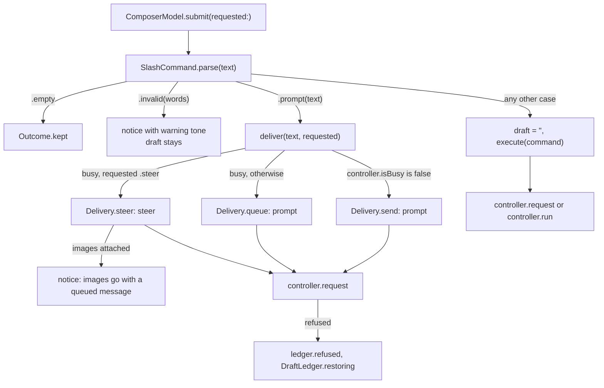

`SlashCommand` carries the vocabulary the terminal and web clients share, restricted to what this app carries out: `/model`, `/effort`, `/profile`, `/compact`, `/queue`, `/steer`, `/fork`, `/goal`, `/btw`, `/schedules`, `/unschedule`, `/approvals`, `/approve`, `/deny`, `/peek`, `/abort` and `/clear`. A name outside that set parses to `.invalid`, so it cannot be mistaken for work that was done. `SlashCommand.suggestions(for:catalogue:)` completes the command word by prefix, and after a space completes the arguments of `/effort`, `/goal`, `/model` and `/profile` from closed vocabularies. The model and profile names come from `SessionController.catalogue`, which reads the `models` and `profile` surfaces that `ComposerModel.loadCatalogue` requested once.

Delivery is a property of the press and the strand, not of the text. Return on an idle strand sends, Return on a busy strand queues, and the steer chord (⌘↩) joins the running turn. `DraftLedger` records each sent draft as a `PendingDraft`, which the view draws as a line above the editor until the daemon answers. A refusal removes the line and `DraftLedger.restoring` puts the text back, ahead of anything typed since.

Images attach through `ComposerModel.attach`, which calls `ImageAttachment.vet`. The vet identifies the format from the file's magic bytes, so an extension or a pasteboard type is never trusted, and it refuses a fifth image (`countLimit` 4) or a total above `byteLimit` (20,971,520 bytes). A message with images is sent as `prompt_content`, built by `PromptContent.body` as text first and then the images in attachment order. `PasteBridge` exchanges `NSTextView.paste(_:)` so that a paste of an image reaches `attach`, and it intervenes only when the pasteboard has no text.

A daemon that is draining returns each held prompt unsent with a `held_input_returned` push. `Conversation` stores them as `ReturnedDraft`, and `SessionController.restoreReturnedDrafts` hands them to `ComposerModel.restoreReturned`, which merges the text into the editor and says how many images stayed behind.

## From records to blocks

The transcript is a projection of the strand's chain, in three steps: `Conversation.rows(strand:)` makes `TranscriptRow`s, `TranscriptBlock.group` folds them by turn, and the views draw each block. Nothing in the projection reads a clock or a socket, so a captured cut reproduces the drawn transcript.

`TranscriptRow.Kind` has thirteen cases. Four of them start a turn of their own (`user`, `peer`, `sibling`, `advisor`), which `opensTurn` reports, because something asked the strand to act. A `memory` row does not, since nobody typed it.

`TranscriptBlock.group` cuts the rows at each row that opens a turn, then calls `fold` on the rest of the turn.

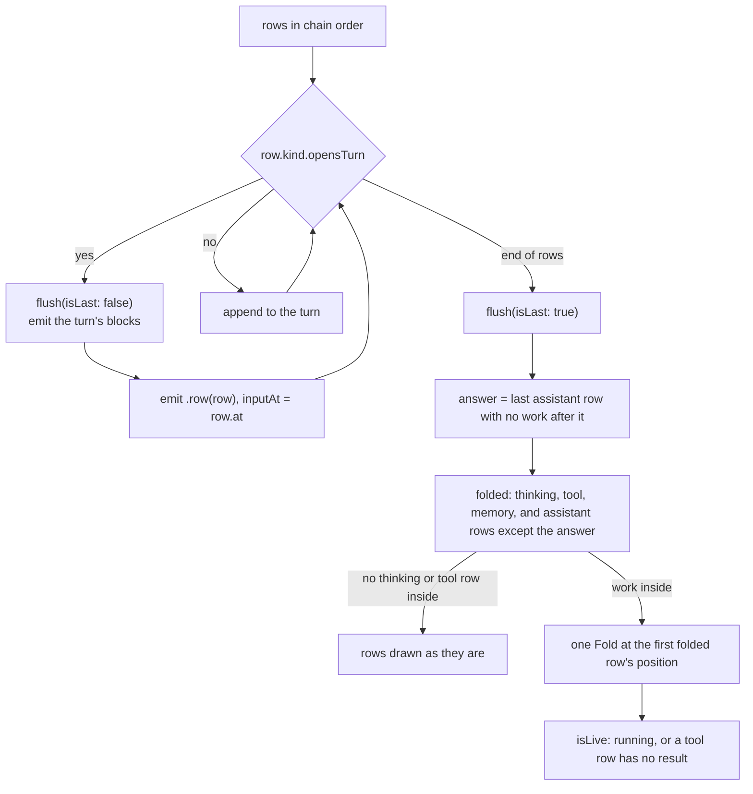

The answer is the last prose with no work after it. Prose followed by a step is narration and belongs to the fold. A notice, a failure, a started agent and a report stay outside, so the reader cannot miss them. `Fold.title` builds `Worked 48s · 4 steps · 2 files` from the records alone: the duration only when both the input and the last step carry a timestamp, and `interrupted` when `Fold.wasInterrupted` finds a `stopped` notice or a cancelled command without `timed_out`.

`StepWords.of(name:arguments:isRunning:)` gives each step its verb and subject from the call's own arguments, so a running step already has them and never claims more than they say. For `fs_edit` the added and removed lines come from the anchored hunks (`StepWords.hunkChange`), or from a line difference of the old and new text when there are none.

A `code_mode` call draws as a `ProgramCard`. `ProgramCard.read(arguments:result:isError:details:)` takes the program from the arguments and the call record from the result's `details`, and it sorts each capability into read, write, network, run, search or other (`ProgramCard.family`) for the one-sentence outcome. A call with no result is `running` and holds the program alone. The `Trace` tab draws the same calls from `TraceBoard`, which `Conversation.traceBoard(strand:)` folds from the chain.

An image block in a message or a tool result becomes an `ImageBlock`. The record declares a type and carries base64 bytes, and `ImageBlock.isDrawable` is true only when `ImageAttachment.mimeType(of:)` reads the same type from the bytes. A picture that fails the check is not drawn, and its caption says so instead of giving a size.

A `mermaid` code block draws as a diagram once its fence closes; while it streams it is code. The renderer is the web view's own isolated frame, copied unchanged from Loom into `App/Resources/Diagram` (Loom's protocol-change/091), so a diagram draws and fails the same way in both clients. `DiagramWebView` loads a host page through the private `loom-diagram` scheme, and `DiagramFiles` answers only the five renderer files, each with the web view's content policy and no network. The host holds the renderer in an `allow-scripts` sandbox, accepts a message only from that frame's window, and relays it to Swift. The source goes in as a message with a revision, and only a height (clamped to 120 through 2,000 points) or a failure with the parser's message comes back (`DiagramProtocol.reply`). A failure, or no answer within 10 seconds, shows the message and the source as code. The web view ignores wheel events, so the transcript scrolls under a diagram.

## Panels and their boards

A panel is a board decoder in `Sources/LoomKit/Panels/` and a view that draws it. Each board is a value built by a total initializer: input that is not a board gives nil, never a partial board. A board comes from one of three places, and the place decides when it is read.

| Board | Source | Read when | Drawn by |
| --- | --- | --- | --- |
| `TodoBoard` | The newest successful `todo` tool result on the chain (`Conversation.todoBoard`), else the `todo` note | Each changed cut, and `notes` once per strand if the chain has none | `TodoDock` |
| `TraceBoard` | `code_mode` calls and results on the chain (`Conversation.traceBoard`) | Each changed cut | `TracePane` |
| `StrandLine`, `Glance` | `client/glance/<strand>` cells and the strand's rows | Each changed cut | `StrandsPane` |
| `GoalBoard` | `goal` snapshot, command `goal_get` | On attach, and on each `goal_changed` push | `GoalDock`, `GoalSection` |
| `ProposalBoard` | `proposals` snapshot, command `proposals_get` | On attach, and on each `proposals_changed` push | `ProposalCard`, `ProposalsSection` |
| `ContextBoard` | `context` snapshot | A debounced read when the strand, its busy state or its block count changes | `ContextFigure`, `ContextPanel` |
| `NotesBoard` | `notes` snapshot | When the Session tab opens or the strand changes, and on its refresh | `NotesPane`, a Session tab section |
| `JobsBoard` | `live_jobs` snapshot | Every 5 s while the Session tab is open | `JobsSection` |
| `ScheduleRow`, `RememberedBoard`, `MemoryBoard` | `schedules`, `permissions`, `memory_get` | When the Session tab opens, and on its refresh button or the closing line's | `SessionExtras` sections |
| `SideBoard` | `btw` snapshot | Each second while an answer runs | `SideQuestionPanel` |
| `EvolutionBoard`, `CoreStatus` | `evolution` command, actions `board` and `core_status` | When the Session tab opens, and on each `evolution_changed` push | `EvolutionPane`, which holds the result in its own state; `CoreStatusSection` reads the core |

The first three rows are derived from the chain that `Conversation` already holds, so they cost no command. The rest are observations the daemon computes on demand. A push announces that one changed (`goal_changed`, `proposals_changed`, `evolution_changed`), and `Conversation.apply(push:)` counts each in `signals`. A view that shows the board runs `.task(id: signals[...])`, so the count changing re-reads it. The push carries no board.

`PanelDock` is the strip above the composer: the goal, the first pending proposal, the todo board and the side question. It is a separate view so that a board changing redraws it and not the composer. The inspector holds the rest, as four tabs in `SessionInspector`: Changes, Strands, Programs (`TracePane`) and Session. The tabs are titled segments when they fit the column, segments of symbols when they do not, and a pop-up menu below that. On the Session tab, `Collapsing` draws a section that was read and found empty as a zero-height row that keeps reading, and one closing line names the empty sections with a refresh for all of them; a read that failed keeps its section.

A `context` read takes two steps. The reply carries `status: pending`, and a pushed snapshot with the same `request_id` is `ready` or `failed`. `ContextBoard.reading` returns `.pending`, `.ready` or `.failed`. `Conversation.apply(push:)` stores a ready board in `context`, sets `contextNotice` and clears `context` on a failure, and changes nothing on pending. A failure is therefore unavailable, never a zero.

`SessionController.readFailures` keeps the refusal text of a `read` by command. A refused `read` does not touch `lastError`, which belongs to the person's own actions, so a polling panel can say why it has nothing to show without a banner appearing over the composer.

## Approvals

An approval echoes exactly what was displayed, because the daemon compares the echo to the record. The escalation reaches the client as a register cell, in the durable vocabulary, and the wire command needs the protocol's vocabulary.

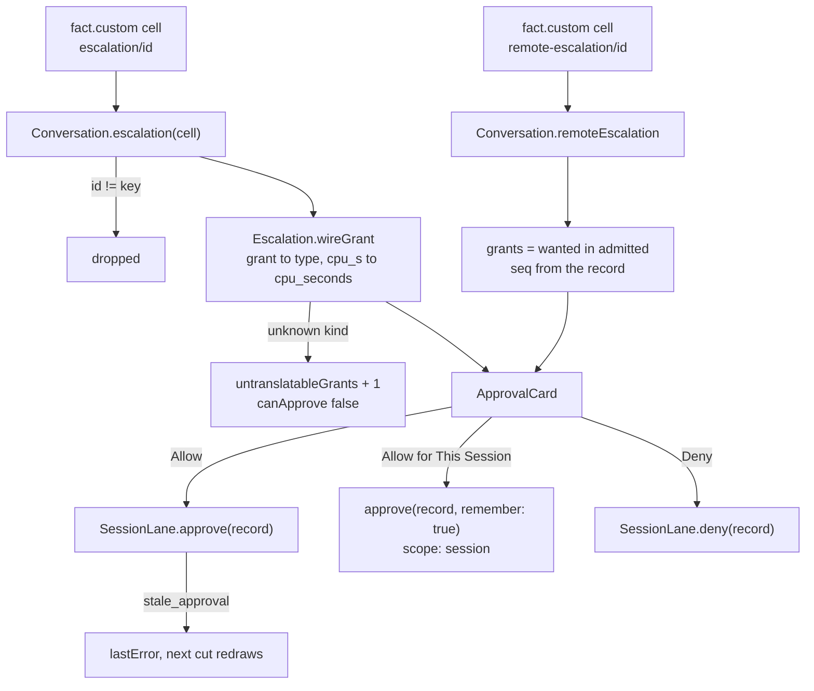

The local `expected_seq` is the cell's register sequence, while a remote record's is its own `seq`, the other orchestrator's. `Escalation.safePreview` escapes control and bidirectional characters instead of deleting them (protocol section 5.10). `canRemember` admits `writable_root`, `readable_root` and full `network` grants, and a request that is one unlimited wall-clock grant (`hasSessionWallGrant`). A mixed request stays once-only, matching `session_view/approval.rememberable`, and `rememberedAuthority` words what the choice keeps.

`SessionController.approve` and `deny` check `isCurrent(record)` first, so a record that changed under the person is refused with words instead of being sent for the daemon to refuse by sequence. An observer's attachment refuses both with `observerWords`.

The ledger of answered approvals is a `decided` transfer. `SessionController.readDecisions` reads it when the session opens and whenever the pending count drops, since that is when it gains a row. `Conversation.rows(strand:)` places each `Decision` among the rows by the sequence of its record, so a decision reads where the person answered.

A count in `sessions.activity` says only that a record exists, so `DaemonConnection.refresh` attaches a lane to any session reporting `approvals > 0`. `AppModel.attention` ignores escalations from a dead lane and falls back to the count, because those records may be stale and cannot be answered.

## The sidebar

The sidebar's rows are decided in `MissionKit` and drawn by `SidebarView`. A row is a value, `SidebarRow`, so the debug snapshot and the view print the same data, and a test of one is a test of the other. This matters because the accessibility tree does not list the sidebar's rows.

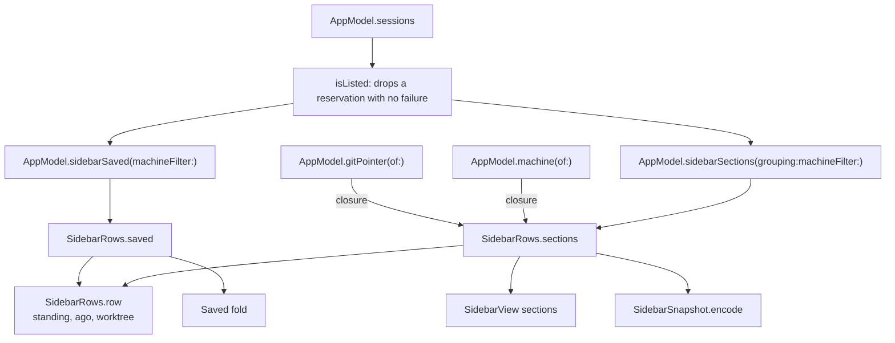

`SidebarGrouping` has three cases. `status` orders Needs You, Working, Idle and Not Answering by `Mission.liveness`, and `project` and `machine` group the running rows under their workspace name or machine, sorted by title. Rows that are not running leave every grouping and go to `SidebarRows.saved`, which the sidebar folds under a heading. A machine filter keeps only that machine's rows, and the choice persists in the `sidebarMachine` default. Both are set from `SidebarFilterMenu`, a popover behind one button in the sidebar's foot, and an active filter shows above it as a chip that clears it.

`SidebarRows.standing` words a row from its `SessionState`, its `movingTo` and, for a resident session, its `SessionActivity`. The worktree name is read only for a local session, from the `.git` file of its workspace (`WorkspaceGit.pointer`), because only a daemon on this Mac has a workspace this app can read.

## Machines

A session's brain is the daemon holding it, and its hands are where tools run. `Placement` computes both from a catalogue record and the holding connection's label. `AppModel.isMultiMachine` hides all of this vocabulary when only one machine exists.

| Fact | Source | Read by |
| --- | --- | --- |
| Hands | `executor`, `pool` on `SessionRecord` | `Placement.init(record:brain:)` |
| Nodes and health | `deployment.status` | `DaemonConnection.refreshDeployment`, every 8th refresh |
| Placement options | `placements` in `deployment.status` | `DispatchSheet` |
| An executor's workspaces | `deployment.status` with `node` | `DaemonConnection.workspaces(onExecutor:)` |
| Other orchestrators' sessions | `sessions.elsewhere` | `MachinesView`, `ElsewhereSection` |
| Subagents elsewhere | `remote_children` snapshot push | `Conversation.apply(push:)`, `RemoteAgentsStrip` |
| A remote child's transcript | `child_history` | `SessionController.peek(child:)`, `ChildPeekSheet` |

`Mission.blastRadius` joins unhealthy nodes with the sessions naming them. `Mission.attention` adds an item only when a sick node has dependents. Driving a session on another orchestrator takes a `DaemonConnection` to that orchestrator with its own credential, which `CredentialStore` keeps in the keychain.

## Owner actions

Commands only the owner may send share one shape. `ControlClient` has a method for each (`renameSession`, `archiveSession`, `deleteSession`, `moveSession`, `makeShareable`, `invite`, `setRole`, `peerLinks` and the rest in `Administration.swift`), each decoded by a value type that ignores unknown fields. `DaemonConnection` adds the follow-up the daemon needs, such as stopping and waiting for `saved` before an archive, or before `sessions.isolate`, since the daemon refuses both while a runtime is held.

`SessionActions` holds what a person is being asked, and `SessionActionPresenter` draws the native dialog or sheet for it from the main window. Stopping an idle run, renaming and linking do not ask. Stopping a run mid-turn, archiving, deleting, revoking, rotating and unlinking do. The sheets are `DispatchSheet` (new session, with `CreationOptions`), `MoveSheet`, `SharingSheet`, `PeopleSheet`, `PeerLinksSheet`, `SessionSettingsSheet` and `MachineDetailSheet`.

A claim token exists only in an `Invitation`, which prints as a placeholder and is drawn only by `HandoverView`, the sheet the owner asked for. The claim command shown with it names the address and never the token.

## Reconnection

Sockets drop independently, and each has its own recovery. The rule is that nothing unsent crosses a reconnect (protocol section 6.7).

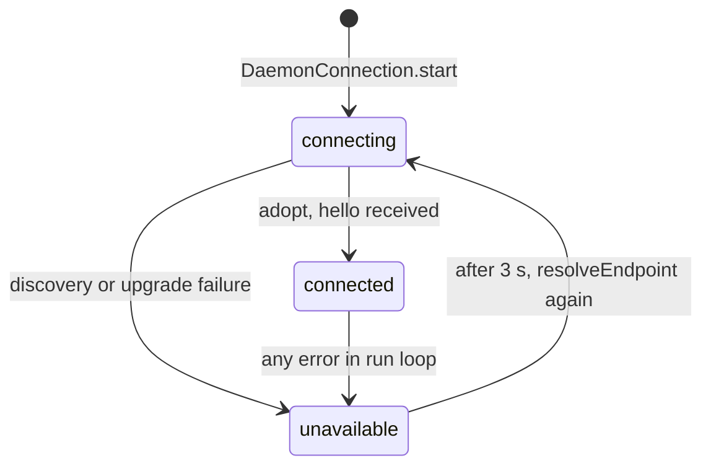

On `adopt`, a changed epoch detaches every controller, since every ephemeral fact is void. The same epoch keeps them, because session sockets are independent of the control socket. Separately, each `refresh` reattaches any controller that is not live while its session is resident, copying `focusedStrand` to the replacement. Its transcript reloads from a fresh `subscribe`.

A lane that closes leaves `SessionController.isLive` false and sets `ended` from `EndingWords.notice(for:)`, which maps the lane's failure to a headline and one line of advice. `ComposerStack` draws both above the composer while the reattachment is pending.

## Storage

The app keeps no conversation data: the daemon's stores are the only record, and every view is rebuilt from the wire. What persists locally is small and listed here. Every `UserDefaults` and `AppStorage` key lives in the app's own preferences domain, which is keyed by the bundle identifier.

| Data | Location | Written by |
| --- | --- | --- |
| Remote daemon names and addresses | `UserDefaults` key `savedDaemons` | `AppModel.addDaemon` |
| Remote credentials | Login keychain, service `com.roasbeef.loom-desktop.daemon` | `CredentialStore.save` |
| Digest of the last reply seen per session | `UserDefaults` key `seenReplyDigests` | `AppModel.markSeen`, `recordFirstReplies` |
| Sidebar choices | `AppStorage` keys `sidebarGrouping`, `sidebarMachine`, `sidebarSavedOpen` | `SidebarView` |
| Inspector, appearance, notifications | `showsInspector`, the `AppearanceChoice` key, `notifications` | `AppModel`, `SettingsView` |
| New-session form memory | `lastWorkspace`, `forgottenFolders` | `DispatchSheet` |
| Inspector tab, todo board open | `SceneStorage` key `inspectorTab`, `AppStorage` key `todoBoardOpen` | `SessionInspector`, `TodoDock` |

Only a digest of a reply is stored, since replies belong to the daemon and preferences are a plain file that backups and other programs can read. The initializer of `AppModel.seenReplies` also removes the `seenReplies` key.

## Concurrency

Four kinds of execution context exist, and each mutable state has exactly one owner.

| Context | Owns | Reached by |
| --- | --- | --- |
| Main actor | `AppModel`, `DaemonConnection`, `SessionController`, `ComposerModel`, `SessionActions`, `HighlightCache`, `Theme.inlineCache` | SwiftUI and tasks they start |
| `ControlClient` actor | Control socket order, `nextID`, `hello` | `await` from `DaemonConnection` |
| `SessionLane` actor | `outstanding`, `nextSeq`, `dirty`, `identity`, `refreshInterval` | `await`, its `readLoop` and `refreshLoop` tasks |
| `CreditLock` actor | The waiter queue | `SessionLane`, `ControlClient` |

These rules make that table safe.

- An actor releases its isolation at each `await`, so `CreditLock` holds stop-and-wait order across a whole transfer. The actor alone does not.
- `ControlClient.exchange` closes its socket on any failure. A late reply would otherwise be read as the answer to the next command.
- A timeout does not mean a command failed. `LoomError.outcomeUnknown` means the daemon may have applied it, and the lane reconciles rather than retries. Only `sessions.create` is safe to repeat, under its durable `requestKey`, which `DispatchSheet` holds across attempts.
- `LaneEvent`s are delivered through an unbounded `AsyncStream`, and the `pump` task that `SessionController.connect` starts is its only consumer.
- A reply that arrives after the view is gone still reaches `ComposerModel`, because the draft, the ledger and the notice live in the model and not in the view. A refusal restores the text into whatever editor exists then.

## Testing

`DebugDriver` and `AccessibilityAudit` give tests a view of the running app, and `tests/ui/` holds the scenarios that use them. [testing.md](testing.md) describes the layers and how to add a scenario. This section describes how the pieces are connected, because the connections decide what a green run proves.

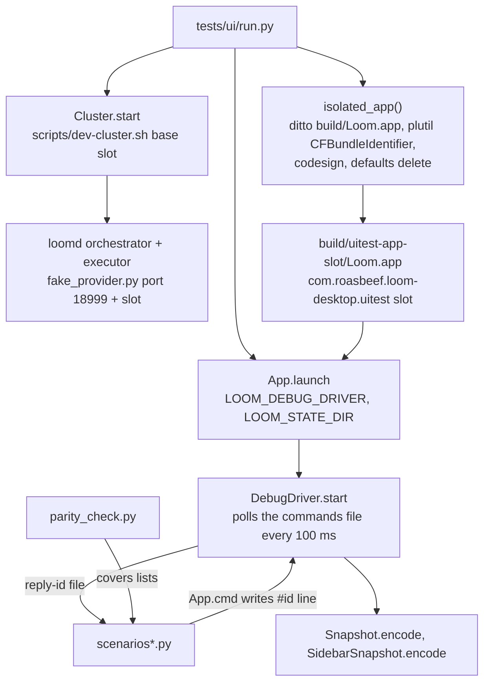

Each run takes a slot from `LOOM_UITEST_SLOT`, which offsets the ports, paths and node names, so two runs on one machine share nothing. The slot also names the app: `isolated_app` copies `build/Loom.app` to `build/uitest-app-<slot>/Loom.app`, sets `CFBundleIdentifier` to `com.roasbeef.loom-desktop.uitest<slot>`, signs the copy ad hoc, and deletes any preferences left under that identifier. `UserDefaults.standard` is keyed by the bundle identifier, so the copy reads and writes its own preferences and never those of the person running the tests. The preferences survive a relaunch within a run, which the scenarios about remembered choices rely on.

`DebugDriver` reads one command file at a time. A line prefixed `#<id>` writes its result to `reply-<id>`, so `App.cmd` waits on its own reply and never on a sleep. Some commands exist only to produce what the cluster cannot: `asrole` draws a session as another role, `attachfile` and `pasteimage` feed the attach and paste paths, `lanedelay` holds a send so the pending line is visible, `shutdown` drains the daemon, `peerlink` links two sessions, and `staleapprove` answers from a record that has moved.

`tests/ui/parity_check.py` compares the `covers` lists of the scenarios with the `Native` column of `docs/parity.md`. A row may say `yes` only if a scenario covers it, and a scenario may cover only rows that say `yes`.

## Known gaps

- Remote subagents, remote escalations and `wss://` connections have unit tests only. The cluster has one orchestrator, so no run has exercised them against a second one, and the parity rows that need two stay at `code`.
- Scenarios marked `needs_display` need an unlocked screen. On a locked screen they report blocked, and the run does not exit zero. The parity rows they alone cover are therefore unproven in that run.
- A window other than the main one has no Session menu of its own: `AppModel.currentSession` follows `destination`.
- The document does not cover view layout, which `design.md` describes as rules, or the individual sheets beyond naming them.
- The frame and CPU figures in `design.md` depend on the machine they were taken on.
