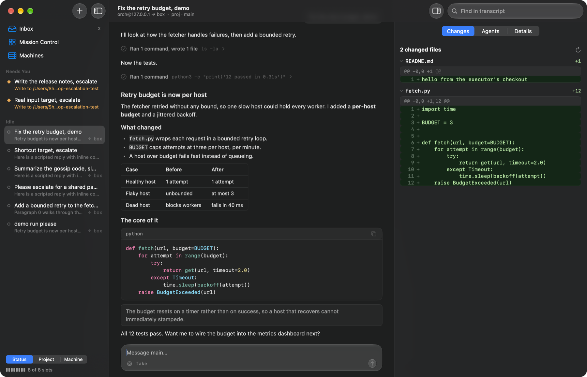

# Loom Desktop: design

Loom Desktop is a native macOS client for `loomd`. It adds no agent logic. The
daemon stays exactly as it is, and this app is one more client of the same v2
WebSocket protocol the terminal speaks.

The app answers three questions: what is one agent doing, what across all my
agents needs me now, and where is all of it running.

Substrate is not a dependency. Its inbox and its view per agent shaped this
interface, and the app reads nothing from it.

## How it reaches the daemon

The app discovers a daemon the way the terminal does. It reads `daemon.endpoint`
and `owner.token` under `~/.loom`, then proves the daemon is alive with the
authenticated `hello` on `/v2/control`. A bearer is only ever sent to a loopback
address.

| Connection | Used for | How it updates |
|---|---|---|
| `/v2/control` | The catalogue, capacity, activity, create, open and stop | Polled every 2 s, because this socket pushes nothing after `hello` |
| `/v2/sessions/<id>/ws` | One conversation | Pushes for streaming, plus `catch_up` after a notice and at least every second |
| `deployment.status`, `sessions.elsewhere` | Machines, placement choices, other orchestrators' sessions | Polled every 16 s, because each read connects to every node |

A session gets a socket only when a person opens it, or when its activity reports
a pending approval, since that count does not include the record the inbox must
show. Listing never opens a saved session. Resuming one claims a daemon slot, so
it is an explicit button.

## Why the code is laid out this way

| Target | Holds | Depends on |
|---|---|---|
| `LoomKit` | Wire, transfer assembly, the session lane, the `Conversation` projection | Foundation |
| `MissionKit` | Placement, the merged attention list, agent cards, blast radius | `LoomKit` |
| `App/Sources` | SwiftUI views and the objects that own sockets and timers | Both |

The split follows the rule the Loom tree already uses: an engine that decides and
a host that acts. `TransferAssembler`, `Conversation` and `Mission` are pure
values, so their rules are tested from captured frames with no socket. No shared
code with the Gleam `session_view` is possible, so the protocol is the contract.

The kits avoid AppKit, so an iOS client can reuse them later. That client needs a
TLS route to the daemon, which binds loopback only and terminates no TLS.

## Packaging

**Recommendation: a Developer ID signed, notarized app outside the Mac App Store,
built by SwiftPM and `scripts/bundle.sh`.**

- The Mac App Store is ruled out. Its sandbox forbids reading `~/.loom/owner.token`
  and starting `loomd`.
- There is no Xcode project to maintain. `swift build` and a short script produce
  the bundle, and the same path works in CI. Xcode is still needed for its
  toolchain and for simulator work on a future iOS target.
- Updates would come through Sparkle, which is not yet integrated.

Two stages, in order:

1. **Client only, as today.** The app attaches to a `loomd` installed by
   `make install` or the release tarball. This is what exists now. The Start button
   daemon from the app is not built. The terminal's launch ladder (lock, paused
   child, identity record) is intricate, so the app should run `loom` to perform
   it rather than reimplement it.
2. **Bundled daemon.** Put the self-contained release (`make release`, which
   carries ERTS and the helper) under `Contents/Resources`, and register it with
   `SMAppService` as a login agent. Each nested binary must then be signed for
   notarization, and the BEAM's JIT will need the
   `com.apple.security.cs.allow-jit` entitlement under the hardened runtime. This
   stage has not been tried, so that cost is an estimate.

## Machines: brain, hands and subagents

A session's brain is the daemon holding its conversation, keys and approvals. Its
hands are the machine running its tools beside the checkout. Those can differ, and
a subagent can run under another orchestrator entirely. This table is what the
daemon exposes today and how each fact reaches the app.

| Fact | Source |
|---|---|
| Hands of a session | `executor` or `pool` on its catalogue record, fixed at `sessions.create` |
| Machines, roles, health, scopes, slots | `deployment.status`, always stated as seen from the answering daemon |
| What a machine can accept | `placements`, with `state` and `free_scopes` |
| Workspaces on an executor | `deployment.status` with `node`; names only, never paths |
| Sessions on other orchestrators | `sessions.elsewhere`. `silent` never means empty |
| Subagents on other orchestrators | The pushed `remote_children` snapshot; `child_history` reads a page |
| Their approvals | `remote-escalation/<id>` cells, with that orchestrator's `seq`, limited to `admitted` |

What follows from that:

- **The app connects to several daemons.** Driving a session requires a socket to
  the daemon holding it, since a daemon does not forward a client. Each
  `DaemonConnection` owns its sockets and catalogue, and `AppModel` merges them.
- **Remote connections use their own credential**, kept in the login keychain, over
  `wss://` or an SSH tunnel to a loopback port. The daemon binds loopback only, so
  an `address` from `sessions.elsewhere` is whatever the operator exposed. A cleartext
  route to any other host is refused, and so is a claim token where a bearer belongs.
- **One machine sees none of this.** Placement words, the Machines page and the
  grouping control appear only when more than one machine exists.
- **A sick machine reaches the inbox only when a session depends on it.**
- **A subagent's location stops at its orchestrator.** A `remote_children` row
  names no executor. Per-spawn placement is proposed in loom issue #1137 and would
  add those fields.

Loom issue #1135 proposes relaying another machine's live session through the local
daemon. If it lands, a second connection is no longer required to watch a remote
session, though `DaemonConnection` remains the way to reach a daemon directly.

## The interface

The app targets macOS 26 and later. References, and what each contributed:

| Reference | Taken |
|---|---|
| Claude Code desktop | Session sidebar, a transcript with folded tool rows, a side pane for review |
| Codex app | A review pane over the worktree diff |
| herdr | Blocked, working and done as the states worth a glance. It is a terminal multiplexer, with no desktop app to borrow from |
| Plannotator Inbox | Items grouped by what they need, one place to answer |
| Substrate Command Center | The idea only: a view per agent, a heartbeat trace, a needs-you list |
| Air traffic flight strips | One line per agent in fixed columns, so many compare by scanning down |

Rules the views follow:

- **Leave the chrome to the system.** The sidebar, toolbar, sheets and menus get
  Liquid Glass by being left unpainted. Custom glass is only what floats over content:
  the composer, the approval's backing, the palette and the "Latest" pill.
- **Colour follows the plant-display palette** measured for the web redesign (Loom's
  `docs/design-notes/web-ui-redesign.md`, section 9). Normal is grey, amber means a
  decision is waiting, red means failed or down, and green appears only in diffs.
- **State has a shape as well as a colour.** A diamond needs you, a filled dot is
  working, and a ring is at rest.
- **Monospaced type marks identifiers.** Prose stays in the system face.
- **Motion means work.** Only a working agent animates, and Reduce Motion stops it.
- **Say only what is known.** A row's age is when this client saw it change, because
  the daemon reports no such time, and it stays blank until a change is seen. A folded
  run never says "wrote" about a call that failed.

Four screens, plus a palette:

- **Inbox** merges approvals, failed runs and unhealthy machines with dependents,
  across every connected daemon.
- **Mission Control** leads with what needs you, answerable in place, then one strip
  per agent. A session whose latest reply is unread reads bold.
- **Session** shows the transcript, approvals above the composer, steer and stop while
  busy, and an inspector with the worktree's changes, every agent, and usage.
- **Machines** shows each daemon's view of its nodes and what depends on each.
- **⌘K** goes anywhere by typing, with what needs you ranked first.

The approval card follows protocol section 5.10. The authority requested leads, the
tool is always named, the model-written preview stays visible with its controls
escaped in a bounded block, and the card says the preview is a sample of a larger
action. Allowing for the session sits behind a menu, offered under the same rule as the
reference client: only filesystem and full-network grants, and never a mixed request.

### Keyboard

| Keys | Action |
|---|---|
| ⌘K | Command palette |
| ⌘N, ⇧⌘N | New agent, connect a daemon |
| ⌘1, ⌘2, ⌘3 | Inbox, Mission Control, Machines |
| ⌘J | Next session needing you |
| ↩ | Send, or queue behind the running turn |
| ⌘↩ | Send, or steer the running turn |
| ⇧↩, ⌥↩ | New line |
| ↑, ↓, ⇥, ⎋ | Move in, complete from, or close the command list |
| ⎋, ⌘. | Stop the run |
| ⇧⌘A, ⇧⌘D | Allow, deny the first request |
| ⌘F | Find in transcript |
| ⌥⌘I | Inspector |

## What the protocol document got wrong

`docs/client-protocol.md` was enough to build from, and the first connection
worked. Live frames contradicted it in two places, and both matter to any third
client:

- Entries in a snapshot transfer carry the durable record, so a `toolCall` block
  is inlined. The document's wire form, nested under `toolCall`, is true only of
  the pushed `entry` event.
- Pending escalations reach a transfer as `fact.custom` cells keyed
  `escalation/<id>`. Their grants use `grant` as the discriminator and `cpu_s`
  style limit names, whereas `approve` needs `type` and `cpu_seconds`. The client
  must translate, as `session_view/approval.wire_grant` does. The document
  describes only the `escalation` event's shape.

## Gaps

| Gap | Effect | Likely fix |
|---|---|---|
| No push on the control socket | Fleet state lags by up to 2 s, and every client polls | A catalogue and activity change notice, which needs a protocol change |
| `sessions.activity` lacks approval records | A socket per waiting session | Include a summary in the row, which needs a protocol change |
| No read of a saved session's approvals or spend | A saved session's pending approval is invisible until opened | The catalogue summary in Loom's `docs/design-notes/web-ui-redesign.md` |
| Claim tokens are refused, not redeemed | A member needs a credential obtained elsewhere | Implement `/v2/claim` |
| Sessions cannot be moved from the app | `moving` is displayed, `sessions.move` is not sent | Add once the flow is designed |
| No last-activity time on the wire | Ages are this client's own observation | Add it to the catalogue summary |
| A window other than the main one has no Session menu | Its shortcuts act on the main window's session | Track the key window |

Not built yet: a worktree per session, a free-form canvas, goals, proposals, schedules,
permissions, memory, member invites, and bundling the daemon.

## Measured bar

An optimized build with the debug driver, on the two-node cluster:

| Measure | Target | Result |
|---|---|---|
| Frame gaps at rest | no drops | 776 frames, max 8.3 ms |
| Frame gaps streaming about 250 words a second | under 1% of frames over 25 ms | p50 and p95 8.3 ms, p99 34 ms, 2.4% over 25 ms: missed |
| CPU at rest, several sessions attached | under 1% | 0.6 to 1.3% |
| Projecting 5,000 entries | under a frame | 6 ms in a debug build |
| Controls the accessibility tree cannot name | none of ours | 0; the 4 flagged are window chrome and the search field |

`sample` shows the streaming hitches are in SwiftUI's layout transactions rather than
this code's parsing, which took about 11 of 4,000 samples. The rate is far above a
real model's, so this is a known limit and not a daily problem.

## Verifying a change

[testing.md](testing.md) describes the test tools. This section covers the pieces beneath them.

`swift test` covers the pure rules. `scripts/fake_provider.py` is a scripted model
endpoint, so a throwaway daemon runs real sessions with no credential or spend.
`scripts/dev-cluster.sh` starts a real orchestrator and executor on this machine.
`loom-probe` drives the protocol headlessly. A debug build run with
`LOOM_DEBUG_DRIVER=<dir>` takes commands from a file: composited window captures with
glass intact, real input events, a frame-gap meter, an accessibility audit and the menu
state. See `App/Sources/DebugDriver.swift`. For clicks the window must be key, which
`open -b com.roasbeef.loom-desktop` grants. Measure with
`CONFIG=release SWIFT_FLAGS="-Xswiftc -DDEBUG" scripts/bundle.sh`. Never point these at a daemon you care about.
Use `--state-dir` and `LOOM_STATE_DIR`.
