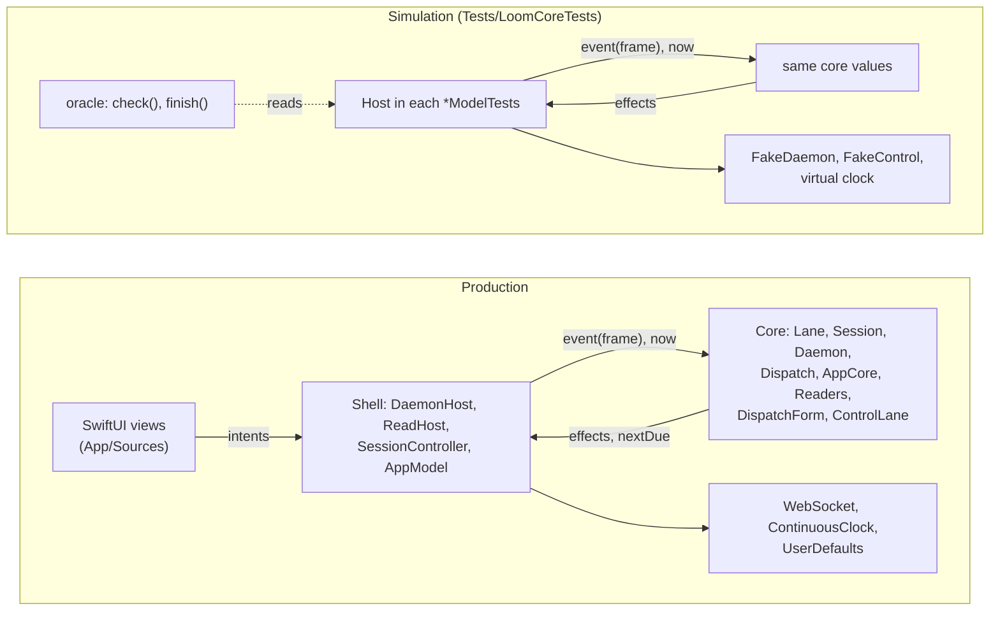
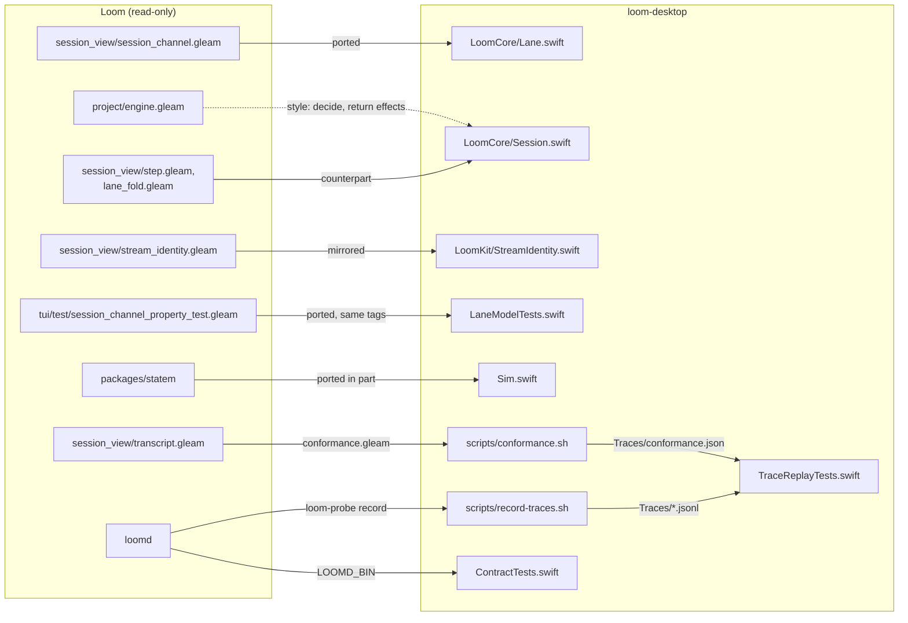
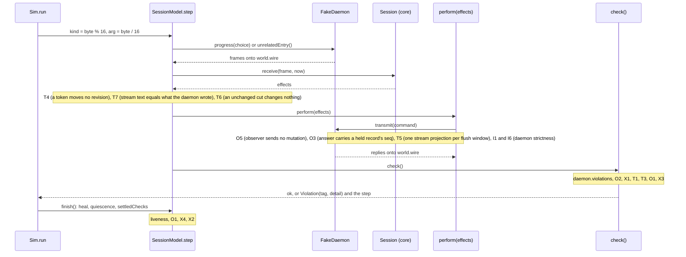

# Testing architecture

loom-desktop is a macOS client of Loom's daemon, `loomd`. Its tests are arranged in layers, and each layer can fail on bugs the others cannot see. This document says what each layer is, what it proves, how the simulation at the center of it runs, and how the whole arrangement is tied to Loom's own Gleam code. It describes the tree at `6aff054`, the merge of PR #23 (the pure core, the deterministic simulation, recorded traces, Loom conformance vectors and headless UI runs). The Loom side was read at `a85349cdd`, read-only.

The reader is assumed to know neither codebase. Terms are defined where they first appear. [core.md](core.md) describes the pure core and its simulation in more detail, and [testing.md](testing.md) is the operating manual for the UI scenarios and the rule for what gates a pull request. This document sits above both: it is the map, and it links into them instead of repeating them.

## The layers

The app is split into three parts. The **core** (`Sources/LoomCore`, plus `LoomKit/ControlLane.swift`) holds every decision as a value: `step(event, now) -> effects`, with `nextDue` naming the one instant at which the core next needs a clock tick. A core value has no `async`, no clock, no timer and no OS call, and `scripts/core-purity.sh` fails `make test` if one appears. The **shell** (`Sources/LoomShell`, and in `App/Sources` the `AppModel`, `DaemonConnection` and `SessionController` classes) owns sockets, timers and the file system. It forwards each frame, with a clock reading, to the core as an event and carries out the effects the core returns, in order. The **views** (SwiftUI, `App/Sources`) draw what the shell publishes.

The upper box is what ships. The lower box runs the same core values with the shell replaced by a `Host` that performs effects the way the shell does, and the socket, daemon and clock replaced by simulated ones. A rule that holds in the simulation holds for the shipped decision, because the decision code is the same code. What the simulation cannot show is whether the shell reports to the core correctly, and whether the views draw what the shell publishes. The upper layers exist for those two questions.

| Layer | Command | What it proves | Bugs it can catch | What it cannot see |
| --- | --- | --- | --- | --- |
| Pure rules (`Tests/LoomKitTests`) | `make test` | Parsing, projection, turn folding, the composer's grammar, panel boards, sidebar rows, markdown, diffs, merge rules, each as a plain function. | A wrong result for a chosen input. | Any ordering or timing, and any input nobody wrote down. |
| Core simulation (`*ModelTests`) | `make test` (short), `make sim` (long) | Seven models (lane, session, daemon, dispatch, app core, readers, form) hold their rules after every step of seeded schedules of frames, ticks, faults and user intents. Liveness holds after a heal. A seed gives the same final state twice. | Races between a reply, a tick and a push; a lost reply; a duplicated or reordered push; a restart; a rule broken only by one order of events. | Anything in the shell or views. A rule nobody wrote an invariant for. Frames the fake daemon does not produce. |
| Host tests (`LoomAppTests`, `DaemonHostTests`, `ReadHostTests`) | `make test` | The real `DaemonHost` and `ReadHost` actors, over a fake control socket and a `HostClock` that a test replaces with a virtual clock, report to and obey the core. `SessionController` reports a closed lane exactly once, and `DaemonConnection` keeps a lane when a stop is refused. | Hung or stale callers, holders and tasks, a timer armed wrongly, a call after `stop`, a report about an old lane ending the new one. | Real sockets. Layout and focus. |
| Recorded traces (`TraceReplayTests`) | `make test` | Frames recorded from a real `loomd` (seven traces) replay through the production `Lane` and `Conversation`, clean and under three push faults (duplicated, swapped, dropped stream deltas), and end with the durable chain and nothing drawn as live. | A frame shape the fake daemon never produces; a decoder that rejects what the real daemon sends. | Behaviors the scripted model did not exercise. A turn that fails before its entry lands is not in the traces. |
| Conformance vectors | `make test` reads them; `make conformance` regenerates | For each trace, the core draws the same user and assistant text, in the same order, as Loom's own `session_view`. | The two clients disagreeing on what was said. | Tool calls and reasoning, which the two clients draw differently by design and the comparison skips. |
| Contract test (`ContractTests`) | `make contract LOOMD_BIN=<loomd>` | The shell's real WebSocket code completes the handshake against a real `loomd` it starts itself, runs one session, and completes a transfer. Skipped unless `LOOMD_BIN` is set. | A broken handshake, a broken socket class, a changed endpoint record. | Anything past the first transfer and one `notes` read. |
| UI scenarios (`Tests/ui`) | `make uitest`, `make uitest-foreground` | The built app, driven through its debug driver against a real orchestrator and executor with a scripted model, does what [parity.md](parity.md) claims, row by row. | Wrong wiring between shell and views; a state the core never saw because the host did not report it; accessibility names; frame and CPU budgets; visual regressions against baselines. | A real model's behavior over a long session. Real VoiceOver. A trackpad. |
| Blind recall (`scripts/recall.sh`) | `make recall WT=<scratch worktree>` | The simulation is judged by reintroducing 25 fixed bugs, one per patch in `scripts/recall`, into the production core and running the generic swarm. A miss is a harness gap. | A weakened invariant, a fault the harness cannot inject, a model that no longer reaches a state. | A bug no one has fixed yet. |
| Cross-process run (`scripts/cross-process.sh`) | `make sim-nightly` runs it; the script runs alone too | The same seeds, run in two processes with different hash seeds, give the same final-state digests. | Iteration over a dictionary or set in hash order, which two runs inside one process cannot show. | Anything that depends on neither. |
| Nightly (`make sim-nightly`) | by hand or by a scheduler | A long campaign, then the cross-process run, then recall when a scratch worktree is given. | The same bugs as above, over more schedules. | The repository has no CI, so nothing schedules this. |
| Planned VM | not working | A macOS guest with its own never-locked screen would run the pixel and foreground scenarios while the owner's desktop stays untouched. [testing.md](testing.md) lists what it needs installed. | n/a | n/a |

Two properties of this table decide how to use it. The simulation and host tests need no screen and no daemon, so they gate every pull request. The UI scenarios gate only a pull request that touches the shell or the views, because a pull request that changes only `Sources/` is covered by the simulation, which runs the production core with only the world replaced.

### The UI scenario classes

A scenario is a Python function in `Tests/ui/scenarios*.py`, registered with `@scenario(..., foreground=..., needs_display=...)`. At this commit `scenarios.ALL` holds 154 scenarios, and each falls in one class.

| Class | How it is decided | Count | Where the window is |
| --- | --- | --- | --- |
| Headless | `Scenario.headless` is true: not foreground, not `needs_display`, and its source (read by `ast`) calls no screen verb (`shot`, `resize`, `key`, `type`, `focus`, `fill`, `hitch`, `take_focus`, `fully_on_screen`, `end_on_screen`) and no rendered driver verb (`sweep`, `click`, `rclick`). It reads only the driver's state and the accessibility tree. | 86 | Parked off the screen. |
| Display | `needs_display=True`. It reads pixels, a frame or a window position. | 33 | On screen. Reports `blocked` on a locked screen, and a run with any blocked scenario does not exit zero. |
| Foreground | `foreground=True`. It needs a key window (real key equivalents, the Session menu's Allow and Deny). Runs only under `--foreground`. | 6 (3 of them also display) | On screen, and takes focus briefly. |
| Other | None of the flags, but the source calls a screen verb, so it is not headless. | 32 | On screen. |

`Tests/ui/run.py` sends the driver `offscreen` before a headless scenario and `onscreen` before any other. The debug driver (`App/Sources/DebugDriver.swift`, compiled into debug builds only) runs the app as an accessory app, which has no Dock tile and is never activated by launching, and moves every ordinary window to `(-30000, -30000)` without hiding it, so its accessibility tree and state stay live. Sheets, popovers and menus stay with what they belong to. A headless scenario therefore runs at any hour without taking the owner's focus. `make uitest` copies `build/Loom.app`, gives the copy its own bundle identifier so it reads its own preferences, and runs against a throwaway cluster; [testing.md](testing.md) has the details and the driver's verbs.

## How it relates to Loom

loom-desktop is a second client of an unchanged `loomd`. The two clients speak the frozen protocol in Loom's [client-protocol.md](https://github.com/roasbeef/loom/blob/main/docs/client-protocol.md) and share no code, because one is Gleam on the BEAM and the other is Swift. The desktop follows Loom's pure state machines as a model, and its tests tie it to them in four ways: ported rules, shared invariant tags, shared timing constants, and recorded frames replayed through both.

### Which Swift type mirrors which Gleam module

| Swift | Gleam | Relationship, from the Swift header comments |
| --- | --- | --- |
| `LoomCore/Lane.swift` `Lane` | `session_view/session_channel.gleam` | A port. Same phases, same stop-and-wait credit, same deadlines. Differences are listed in `Lane`'s doc comment: a FIFO of waiting commands where Loom holds one, a refused catch-up on a lane that holds a cut retried at the next refresh instead of closing the lane, no goal-board read, no early refresh after a completed ticketed transfer, and a `resumed` reply to `catch_up` treated as a protocol violation. |
| `LoomCore/Session.swift` `Session` | `session_view/step.gleam` (with `lane_fold.gleam`) | The desktop's counterpart. It decides what a view is shown when (projection timing, draft custody, stream flush). |
| `LoomKit/StreamIdentity.swift` | `session_view/stream_identity.gleam` | A mirror of the four-item identity `["generation"\|"poll", step, attempt, entry]`. Any other shape stays opaque. |
| `LoomKit/Conversation.swift` `Conversation` | `session_view/transcript.gleam`, `event_fold.gleam` | Folds cuts and pushes into rows. It is checked against `transcript.project` through the conformance vectors. |
| `Tests/LoomCoreTests/Sim.swift` | `packages/statem` | "A Swift port of the parts of Loom's `statem` that matter here": seeded generation, check after every step, shrink by deletion, replay. |
| `LaneModelTests.swift` | `tui/test/session_channel_property_test.gleam` | A port, with the same oracle (it rebuilds what a daemon would know from the frames the lane wrote, and never reads the lane's state) and the same tags. |
| `Daemon`, `Dispatch`, `AppCore`, `Readers`, `DispatchForm` | none directly | Written in the style of `project/engine.gleam` (`apply` an event, get the next state and effects, no clock, no process), which is the model [core.md](core.md) names. Their rules are the app's own. |
| `MissionKit/InboxRule.swift` and the other `*Rule.swift` files | `web_view/inbox_rule.gleam`, `attention_rule.gleam`, `thread_words.gleam` and others | Rules mirrored so the same ticket lands in the same group on both clients. Their tests port the Gleam suites' named cases. |

### The portable-subset rule

`docs/gleam-style.md` Part IV section 5 holds `core`, `machine` and `prompt` (and, per `CLAUDE.md`, `statem`, `session_view` and others) to no `@external` and no `gleam_erlang` or `gleam_otp`, so their state space can be tested without spawning processes. The desktop applies the same rule to `LoomCore` with `scripts/core-purity.sh`. That script forbids `async`, `await`, `Task`, `Date(`, the clocks, `UserDefaults`, `FileManager`, `URLSession`, `DispatchQueue`, `Process(` and a few more, after stripping comments, over `Sources/LoomCore` and `LoomKit/ControlLane.swift`. The Gleam text says the portable subset is good for "decide but not act", and that is also what a core value does here.

### Shared invariant tags

The lane's tags are Loom's own, from `session_channel_property_test.gleam`, and `LaneModelTests.swift` checks them with the same meaning: I1 to I8 (credit, identities, mutation at most once, waiting mutations, close, transfers, stale replies, pushes), L1 to L5 (answers, notices, refresh, deadlines, admission) and N1 (`nextDue` is exact). The full table is below. The tags diverge in these places:

- Loom's property test says a close the client asked for reports neither an unknown outcome nor "definitely not sent", and a waiting read is dropped silently on failure. `LaneModelTests` documents the opposite for both: a close the client asked for reports the same outcomes as a failure (without a `failed` reason), and a waiting read is reported failed.
- Loom's L5 is "admission follows ADR-010". The Swift L5 states the rule in the lane's own terms: a closed lane refuses, an observer's mutation is refused once the role is known, and a mutation before the first cut waits.
- `I1` and `I6` are also recorded by `FakeDaemon` and `FakeControl`, as the daemon's strictness: a command that arrives while a reply is owed, or a `snapshot_next` that names the wrong index, is a violation the client caused.
- The app's own tags (T, X, O, B, F, H, N2, N3, P, R) have no Loom counterpart. `N2` and `N3` are notices and share a letter with Loom's `N1` only by accident. `B7` is used by two models with two meanings (see the table below).

### The stream hand-off rule

A reply streams as ephemeral `stream_delta` pushes before its durable entry exists. Both clients follow one rule: a stream that names a reserved entry (the fourth item of its generation identity) is shown until that exact entry is held, and an unrelated entry landing on any strand says nothing about it. Loom states this in `stream_identity.gleam` and applies it in `transcript_lines.response_recorded` and `event_fold.gleam` (a named response "remains visible until its exact record replaces it"). The Swift side applies it in `Conversation.apply(cut:)` and `applyDelta`, and `StreamHandoffTests` fails on the old rule ("any landed entry removes every ended stream"). A stream with no reservation, from an older daemon, keeps the old behavior on both clients.

The clients differ on how a stream that will never get its entry is retired, because a turn can fail before writing one. Loom's `response_awaited` keeps drawing the stream while the capture's `operations` map still shows the operation running on the strand. The desktop first tried treating an idle strand in a cut as proof that the entry is gone, and withdrew it, because a cut can be older than a push that reached the client first. It retires the stream when a cut carries the daemon's operation-keyed result, `fact.custom/operation-result/{op}`, which is written once in the transaction that ends the operation and is never overwritten (`Conversation.pruneConcluded`). This is a deliberate divergence, checked by rule X2.

### Timing constants

| Constant | Value | Swift | Loom source |
| --- | --- | --- | --- |
| Command reply deadline | 10 s | `Lane.commandDeadlineMs`, `Lane.swift:55` | `session_channel.gleam:2039` (`deadline: now + 10_000`). The protocol document gives 6 s as the daemon's own bound for answering one command (`client-protocol.md` section 4.2 and the section 8 timeout table), so the lane waits longer than the daemon takes. |
| Capture and transfer deadline | 30 s | `Lane.captureDeadlineMs`, `Lane.swift:57` | `session_channel.gleam:499`, `557`, `1688`; the section 8 table gives the transfer lifetime as 30000 ms, absolute from capture, not extended by a fragment. |
| Idle refresh before any push | 250 ms | `Lane.pollingRefreshMs`, `Lane.swift:59` | `session_channel.polling_refresh_ms`, `session_channel.gleam:298`; the section 8 table recommends 250 ms. |
| Idle refresh after a push | 5 s | `Lane.pushingRefreshMs`, `Lane.swift:61` | `session_channel.pushing_refresh_ms`, `session_channel.gleam:314`. |
| Control command reply | 6 s, 16 s for `sessions.review` | `ControlLane.deadlineMs(for:)` | `client-protocol.md` section 4.2 (6 s). The 16 s allowance for `sessions.review` has no cited Loom counterpart. |
| Hello deadline | 6 s | `ControlLane.helloDeadlineMs` | none cited. |

The 10 s command deadline and the 5 s pushing refresh are Loom's implementation constants, not protocol text. `LaneModelTests` straddles every one of these constants with its tick sizes, and rule N1 requires that a tick one millisecond before `nextDue` changes nothing.

### How `scripts/conformance.sh` turns traces into vectors

`make record LOOMD_BIN=<loomd>` runs `scripts/record-traces.sh`, which starts its own `loomd` (state directory under `build/trace-run`, port 17741, the scripted model `scripts/fake_provider.py` on port 19741, no provider key) and records each scenario with `loom-probe record`. A trace is a file of JSON lines `{"d": "tx"|"rx", "f": <frame>, "t": <ms>}`. Seven are committed in `Tests/LoomCoreTests/Traces`: `plain`, `think`, `tour`, `stopmid`, `explode`, `escalate` and `two`.

`make conformance LOOM_CHECKOUT=<loom checkout>` then does four things. It builds a scratch Gleam project under `build/conformance` that depends by path on the checkout's `core` and `session_view`, so nothing is added to the Loom checkout. A Python step turns each trace into a generated module, `traces.gleam`, of `#(direction, frame)` pairs. `scripts/conformance/src/conformance.gleam` feeds the received frames through the same transfer decoder the terminal uses (`snapshot`), accumulating the window across catch-up cuts, and draws the strand with `snapshot_view.decode` and `transcript.project`. The JSON it prints becomes `Traces/conformance.json`. The Swift test `testTheCoreAgreesWithLoomsOwnProjection` replays each trace through the core and requires the user and assistant lines to match, in order. The Swift test reads the committed JSON, so Loom is needed only to regenerate it.

### What keeps the two clients from drifting, and what does not

What does:

- **Same oracle for the lane.** `LaneModelTests` carries Loom's tags, and its ticks straddle Loom's constants.
- **Recorded real frames.** The traces come from a real `loomd`, and `TraceReplayTests` runs them through the production lane and conversation. A decoder that rejects a real frame fails there.
- **Conformance vectors.** The same frames go through Loom's `session_view` and the results are compared (speech only).
- **The contract test.** The real shell code against a real daemon, when someone runs it.
- **The purity script.** The core stays a function of its arguments, which keeps the comparison meaningful.

What does not:

- **The fake daemon's frames are not compared with the real daemon's.** `FakeDaemon` builds frames with `Frames.swift`, which writes object keys in sorted order (`Frames.swift:34`). The real daemon writes `v`, `reply_to`, `event`, `body`, in that order (line 2 of `Traces/plain.jsonl`). The field order, and for that matter the field set, of the fake has never been checked against the real one. The same kind of gap existed for values: the fake always sent `oldest_seq` where the real daemon sends null on catch-up cuts, until the traces showed it (`a158167`).
- **Regeneration is manual.** Nothing runs `make conformance` or `make record` when Loom changes. A Loom change that alters what `session_view` draws is invisible until someone regenerates the vectors, and the committed vectors keep the Swift test green meanwhile.
- **Speech only.** Tool calls and reasoning are not compared.
- **The Swift mirrors are by hand.** Nothing checks that `Lane.swift` still equals `session_channel.gleam` apart from the behaviors the shared tags and constants pin.

## How a run works

A **model** is one simulated subsystem: a `SimSpec` that builds a world around a production core value, executes one scripted step per seed byte, and checks rules after each step. There are seven: `LaneModel`, `SessionModel`, `DaemonModel`, `DispatchModel`, `AppCoreModel`, `ReadersModel` and `DispatchFormModel`. `Sim.run` (`Sim.swift:117`) drives any of them.

### The seed

A seed is a byte string (`Sim.Seed`, `Sim.swift:51`):

| Bytes | Meaning |
| --- | --- |
| 0 | Mode. `byte % modes` selects a configuration of production. Every model has two modes. `SessionModel` mode 1 starts with a reply already streaming. `LaneModel` uses the mode for the role (`operator` or `observer`). |
| 1 and 2 | Fault mask, little endian, one bit per fault class. A seed shorter than three bytes runs with every class on. |
| 3 and on | Ops, truncated to the model's `maxSteps` (48 to 64). An op byte `value` is decoded as `value % 16`, the kind of action, and `value / 16`, its argument. |

An op whose fault class is masked off performs an honest action instead, so every seed makes progress, and any sub-list of a seed is still a valid seed, which is what makes shrinking by deletion work. The order seed, which breaks ties between events due at the same instant, is an FNV-1a hash of the op bytes mixed with the mode and mask (`Seed.orderSeed`), so deleting an op changes it. Randomness comes from SplitMix64 (`SimRandom`), which gives the same stream on every platform.

### The four phases

1. **Setup.** `makeWorld(mode:faults:rng:)` builds fresh stores, the production core value, the simulated daemon and time zero.
2. **Scripted.** `step(_:kind:arg:rng:)` runs once per op byte, then the model's invariants run and the first broken rule throws a `Sim.Violation(tag, detail)`.
3. **Heal.** `finish` turns every fault off and lets the world finish its work, moving time to the core's `nextDue`, for up to 400 rounds in `SessionModel` and 300 in `DaemonModel`. The heal may not reconnect or reset anything that production would not reconnect or reset itself. In the session model, the host reattaches a lane 3 s after it ends (`reattachAt = now + 3_000` in `SessionModelTests.perform`), standing in for the attach the catalogue poll makes in the app.
4. **Settle and snapshot.** The model then checks quiescence (the session is attached, nothing waits, every draft is settled, the cursor has caught up), runs two extra 31 s idle ticks so the lane's idle refresh (at most 30 s away) can repair a change that moved no durable record, and runs the settled checks. `snapshot` returns the final state itself, not a summary.

### How faults enter

A fault is injected only at a boundary production already has: a socket, a reply, the daemon, or the clock. The simulation never edits a core value's fields. The session model drops a reply after the daemon applied the command, delivers the last push twice, swaps two queued pushes, closes the socket mid-transfer, or drops a prompt on its way to the daemon. The daemon model closes the control socket mid-poll, restarts the fake daemon with a new epoch, refuses a poll, takes the daemon down so the socket cannot open, or reports a replaced controller's end late. All of these arrive at the core as ordinary events (`receive(frame)`, `receive(failed:)`, `tick(now)`). The per-model alphabet is in the table below.

### The oracle

The oracle is four mechanisms, and a run fails when any of them objects.

1. **Invariants after every step.** Each model's `check` function (and checks inside `deliver` and `perform`) look at the state after each op and throw the first rule that does not hold. These are the rules in the table below.
2. **The fake daemon's reference chain.** `FakeDaemon` keeps the durable entries the real daemon would hold, and it is strict where the real daemon is: one command in flight per socket, one transfer open at a time, `snapshot_next` named by index. A client that breaks one of those is recorded in `violations` under the lane's tag. At the end, the transcript the core shows must equal the daemon's chain (`liveness`), and each message the daemon applied must be in the transcript and not the editor (`O1`).
3. **Liveness after the heal.** After faults stop and time advances, the system must reach rest: nothing in flight, nothing waiting, the catalogue equal to the daemon's, every command settled. A bug that strands state forever cannot hide behind the faults that caused it, because the faults are off.
4. **The double-run snapshot compare.** `Sim.corpus` runs each fixed seed twice and compares the full final snapshots, and `scripts/cross-process.sh` compares digests of the same seeds across two processes with different hash seeds. A difference means production code or the harness depends on something outside the seed, such as an unordered iteration.

The diagram shows one step of `SessionModel`. The three notes on the right are where each rule is evaluated: some inside the delivery of a frame, some while effects are performed, some in `check`, and the last group only after the heal, because they hold only once every turn has settled.

### Shrinking and replay

When a seed fails, `Sim.shrink` (`Sim.swift:185`) first deletes runs of ops, halving the chunk size, then clears fault bits, and keeps a candidate only if it fails with the same tag, within a budget of 3,000 candidate runs. The report names the generator seed, the run index, the step, the rule and both the original and the shrunk seed in hex. `make sim-replay MODEL=SessionModelTests SEED=<hex>` sets `SIM_REPLAY`, and the model's `testReplay` prints one line per step (`mode`, `faults`, then `step i: kind k arg a` and the snapshot) and then either `finish ok` or `VIOLATION`. A seed that once failed is kept as a regression seed (`DaemonModelTests.testTheRegressionSeedsPass`, for example).

### Blind recall

A simulation that finds nothing might be good or might be blind. Recall measures which. `scripts/recall/*.patch` each reintroduce one fixed bug into the production core, and the first line of the patch names the model expected to find it. `scripts/recall.sh <scratch worktree>` applies one patch at a time in a scratch worktree (a checkout of the same commit, outside `/tmp`, made with `git cow add`), runs the generic swarm from generator seed 1 (the test runs `generator` and `generator + 1`) with `RECALL_RUNS` seeds per generator (default 20,000), and prints the run at which it failed or `missed`. Nothing in the harness is specific to a patch. PR #23 reports 25 of 25 found, and the table in `docs/core.md` and the PR body has the run each was found at. A miss has three outcomes in practice: add an invariant, add a fault class, or fix a model that stopped reaching a state. The misses recorded so far were a notices patch that posted nothing and passed N2 (N3 was added), a replacing session that dropped its ledger and could not lose a message because no prompt ever failed to reach the daemon (the lost-request fault was added), and patches that ran nothing because the script named the test wrongly.

## Invariant tags

Taken from the `Sim.Violation(...)` calls and the models' header comments. "File" is under `Tests/LoomCoreTests`. Tags in the first group are Loom's.

| Tag | Meaning | File |
| --- | --- | --- |
| I1 | A correlated command is written only while no request awaits its reply, except the `snapshot_next` a transfer's own reply grants. | `LaneModelTests`; strictness in `FakeDaemon`, `FakeControl` |
| I2 | Request identities strictly increase. | `LaneModelTests` |
| I3 | A mutation crosses the wire at most once, and a lane that fails while one awaits its reply reports an unknown outcome for exactly that identity, once. | `LaneModelTests` |
| I4 | A waiting mutation is later written once or reported not sent once, never both. | `LaneModelTests` |
| I5 | Nothing is written after the close, there is one close, and a closed lane is inert. A closed session does not report its end twice. | `LaneModelTests`; `SessionModelTests` |
| I6 | One `snapshot_next` per granted fragment, naming the granted transfer and index. | `LaneModelTests`; strictness in `FakeDaemon` |
| I7 | A reply with a stale `reply_to` produces no update and closes the lane. | `LaneModelTests` |
| I8 | A pushed frame allocates no identity, spends no credit and cannot fail the lane. | `LaneModelTests` |
| L1 | A well-formed answer never fails the lane and yields exactly its own update. | `LaneModelTests` |
| L2 | A notice at or above the cut, received while a request was in flight, is captured at the next ready transition. | `LaneModelTests` |
| L3 | An idle lane with a cut issues its catch-up once its refresh interval has passed (250 ms before a push, 5 s after). | `LaneModelTests` |
| L4 | An in-flight request fails the lane on the first tick at or past its deadline (10 s command, 30 s capture), and not before. | `LaneModelTests` |
| L5 | Admission: a closed lane refuses, an observer's mutation is refused once the role is known, a mutation before the first cut waits. | `LaneModelTests` |
| N1 | `nextDue` is exact: a tick one millisecond before changes nothing, a tick at it acts, and a lane naming none is unchanged by any late tick. | `LaneModelTests` |
| T1 | The durable rows of a strand only grow, except through `/clear`, a strand change or a new attachment. | `SessionModelTests` |
| T3 | A reply's text is in the live stream or its reserved durable row from its first delta until the entry lands, and not in both once the stream has ended. | `SessionModelTests` |
| T4 | A streamed token changes no projection and no revision except through the stream flush. | `SessionModelTests` |
| T5 | The stream is projected at most once per flush window (the check uses the shortest, 33 ms). | `SessionModelTests` |
| T6 | A cut of a daemon that has not changed since the last cut changes nothing observed. | `SessionModelTests` |
| T7 | When a stream ends and the session received every fragment once and in order, the text it holds is exactly what the daemon wrote. Skipped when duplicate or reorder faults are injected. | `SessionModelTests` |
| X1 | A block appears once in the transcript. | `SessionModelTests` |
| X2 | Once every turn has settled, nothing is still drawn as live. | `SessionModelTests` |
| X3 | An approval appears once, and only one the daemon raised. | `SessionModelTests` |
| X4 | Once every turn has settled, no approval stays drawn as pending after the daemon decided it. | `SessionModelTests` |
| O1 | A message the person sent is in exactly one place: the editor, a pending line, or the transcript. After the heal, an applied message is in the transcript and not the editor, and an unapplied one is in the editor. | `SessionModelTests` |
| O2 | One `prompt` or `steer` crosses the wire per message (session); the first prompt of a dispatch is written at most once per session (dispatch). | `SessionModelTests`, `DispatchModelTests` |
| O3 | An answer to an approval carries the sequence of a record the session held when the person answered. | `SessionModelTests` |
| O4 | One request key names one set of create parameters, one session per key, and the key moves exactly when a create parameter changes. | `DispatchFormModelTests`, `DispatchModelTests` |
| O5 | An observer's session sends no mutation. | `SessionModelTests` |
| B1 | The Dock label the shell was last told equals the board's. | `AppCoreModelTests` |
| B2 | The board equals `InboxRule.board` recomputed from the facts. | `AppCoreModelTests` |
| B3 | The open thread is a row on the board, or marked resolved, or none, and a refresh never moves it. Settling twice from the same facts changes nothing. | `AppCoreModelTests` |
| B4 | The place shown is a listed session, or the core moved it to the inbox and said why. | `AppCoreModelTests` |
| B5 | The project selection names a project the core holds. | `AppCoreModelTests` |
| B6 | No lane of an earlier epoch survives the `hello` of a new one. | `DaemonModelTests` |
| B7 | In `DaemonModelTests`: after the heal, every resident session with an approval has a lane, and an ended lane is replaced with its inheritance, never fresh. In `AppCoreModelTests`: a session shows no unseen mark while it is the place shown. | both files |
| F1 | A resident session goes at most three polls with no attention read covering it. | `DaemonModelTests` |
| H2 | A dispatch reports `sent` only if the first prompt was written and acknowledged. | `DispatchModelTests` |
| H6 | The control lane never writes a background command while an owner command waits. | `DaemonModelTests` |
| N2 | A notice is posted at most once per row and kind, and removed when its row leaves the board. | `AppCoreModelTests` |
| N3 | A new ask posts a notice. | `AppCoreModelTests` |
| P1 | Every persisted value decodes to the state it came from. | `AppCoreModelTests` |
| P2 | Nothing persisted but reply digests. | `AppCoreModelTests` |
| R0 | Only a shown surface is read. | `ReadersModelTests` |
| R1 | One read in flight per surface, and none sooner than its period. | `ReadersModelTests` |
| R2 | No budget class passes the daemon's limit in any 4 s window (six `session.brief`, two `sessions.review`). | `ReadersModelTests` |
| R3 | After the heal, every shown readable surface was read within its period plus the budget's wait. | `ReadersModelTests` |
| R5 | A surface that becomes shown, with budget to spare, is read at once. | `ReadersModelTests` |
| R6 | No read starts before the surface's settle time has passed since it became shown. | `ReadersModelTests` |
| cleanup | A session made without the worktree the form asked for is not left behind. | `DispatchModelTests` |
| liveness | After the heal: the session is attached, nothing waits, every draft is settled, and the transcript equals the daemon's chain; the catalogue equals the daemon's; every command and dispatch attempt ends with one outcome. | `SessionModelTests`, `DaemonModelTests`, `DispatchModelTests` |

Rule T2 (row identity at the live tail) does not exist in the code: the owner has not decided it. The audit's B1, B4, B5, O3 and O5 were unchecked at first and are all checked now. The header comment of `SessionModel` lists only O1, O2, T1 and T3 to T6, while the file also checks T7, X1 to X4, O3 and O5, so the code is the authority.

## Fault alphabets

One bit per class, in the order of each model's `Fault` enum. An op whose class is off acts honestly.

| Model | Bit | Fault | How it enters |
| --- | --- | --- | --- |
| `LaneModel` | 0 | refuse | The daemon answers the outstanding request with a refusal code. |
| | 1 | stale | A reply whose `reply_to` is not the outstanding identity. |
| | 2 | garbage | A frame that is not JSON. |
| | 3 | disconnect | The socket reports its end. |
| | 4 | close | The host closes the lane. |
| | 5 | notice | A commit notice below the cut (an old notice). |
| `SessionModel` | 0 | lostReply | An inbound reply is dropped after the daemon applied the command. |
| | 1 | duplicate | The last push is delivered again. |
| | 2 | reorder | Two queued pushes swap. |
| | 3 | disconnect | The socket closes at any step, including inside a transfer. |
| | 4 | lostRequest | A prompt or steer is dropped on the way to the daemon, which never sees it. |
| | 5 | observer | The session attaches as an observer. |
| `DaemonModel` | 0 | lostReply | The reply to a command is lost. |
| | 1 | closeSocket | The control socket closes mid-poll. |
| | 2 | restart | The daemon restarts: a new epoch, the same sessions. |
| | 3 | laneEnds | A lane ends under a session. |
| | 4 | refusePoll | The daemon refuses the poll's commands. |
| | 5 | daemonDown | The daemon is down and the socket cannot be opened. |
| | 6 | lateEnd | A controller that was replaced reports its end late. |
| `DispatchModel` | 0 | createLost | The create reply is lost after the daemon applied it. |
| | 1 | createRefused | The create is refused. |
| | 2 | openFails | The open fails. |
| | 3 | promptRefused | The first prompt is refused. |
| | 4 | promptLost | The first prompt's reply is lost. |
| | 5 | worktreeIgnored | The daemon ignores the worktree the form asked for. |
| `AppCoreModel` | 0 | vanish | A session vanishes from the listing. |
| | 1 | feedGone | A session's feed row disappears. |
| | 2 | restart | The app quits and starts again from what was persisted. |
| | 3 | replyChanges | A reply changes under an open session. |
| `ReadersModel` | 0 | fails | A read fails. |
| | 1 | slow | A read is slow (3 s). |
| `DispatchFormModel` | 0 | replyLost | The create reply is lost after the daemon applied it. |
| | 1 | worktreeIgnored | The daemon ignores the worktree. |
| | 2 | promptLost | The first prompt is not acknowledged. |
| | 3 | refused | The create is refused. |
| `TraceReplayTests` (not a mask) | n/a | `duplicatePushes`, `swapPushes`, `dropStreams` | Applied to recorded `stream_delta` pushes. A reply is never touched. |

## Commands

Times for `make test` are the figures PR #23 measured (debug build). The simulation times are estimates from that PR's measured debug throughput (schedules per second: lane 7,072, session 425, daemon 2,751, dispatch 15,147, app core 877, readers 145, form 50,932), counting both generators each test runs. They were not timed for this document.

| Target | For | Time |
| --- | --- | --- |
| `make test` | `scripts/core-purity.sh`, then `swift test`: unit tests plus a short run of every model (default runs: lane 6,000, session 1,500, daemon 1,500, dispatch 3,000, app core 1,500, readers 500, form 3,000, per generator). Gates every pull request. | about 45 s wall |
| `make sim SIM_RUNS=n SIM_SEED=s` | A long reproducible campaign over `LoomCoreTests.*ModelTests` (default 20,000 runs, seed 1). | roughly 7 minutes at the default, dominated by the readers model |
| `make sim-replay MODEL=<class> SEED=<hex>` | One seed, step by step. | not timed |
| `SIM_BENCH=1 swift test --filter SimBenchTests` | Schedules per second per model. | about 15 s of runs, by the throughput figures |
| `make coverage` | Line coverage of the core under the simulations alone (PR #23: 93.1% of lines over `Sources/LoomCore` and `ControlLane.swift`). | a few minutes, not timed |
| `make recall WT=<scratch worktree>` | Blind recall over the 25 patches. | not timed; each patch is a rebuild plus up to 20,000 runs per generator |
| `make record LOOMD_BIN=<loomd>` | Record traces from a real `loomd` it starts itself (port 17741, never 7440 or `~/.loom`). | not timed |
| `make conformance LOOM_CHECKOUT=<loom>` | Regenerate `Traces/conformance.json` from Loom's `session_view`. | needs a Gleam build, not timed |
| `make contract LOOMD_BIN=<loomd>` | The shell's real sockets against a real `loomd` (port 17743, scratch state directory). Skipped without `LOOMD_BIN`. | not timed |
| `scripts/cross-process.sh` | The same seeds in two processes with different hash seeds (300 per model by default). | two `swift test` runs |
| `make sim-nightly [WT=<worktree>]` | A campaign of 100,000 runs per model with a day-of-year generator seed, then the cross-process run (1,000 seeds), then recall if `WT` is given. The log is `build/nightly/<date>.log`. | about 40 minutes at the defaults, by the throughput figures |
| `make core-purity` | The purity script alone. | about a second |
| `make uitest`, `make uitest-foreground` | The UI scenarios, without and with the key-window scenarios. | about 25 minutes (the figure [testing.md](testing.md) gives for a run) |
| `make uitest-update` | Accept the current screens as visual baselines (`appearance_and_size_matrix`). | not timed |
| `make parity` | Fail if `docs/parity.md` claims a capability no scenario covers, or a scenario names a row that is not `yes`. | under a second |
| `make app`, `make run` | Build `build/Loom.app` (release), and open it. | not a test |

## What the infrastructure has found so far

Three counts, kept separate, because they answer different questions: what the simulation can find unaided, what only the upper layers can find, and what reading found. They come from PR #23's body, [core.md](core.md) and the commit log (`12651da..6aff054`, 63 commits including the merge).

**Found by the simulation itself.** A rule failed with no one pointing at the code.

1. A failed turn's stream stayed drawn (X2, fixed in `9a6105e`).
2. Once the fake daemon sent `oldest_seq` as the real one does, a lost message could never settle (liveness, `a158167`).
3. Rule B4 showed that the core never moved the window off a session no daemon lists (`5d2dff7`).
4. Rule O5 showed that an observer lane sent a queued mutation (`4fec1db`).

Earlier in the work, two to three more: the form key ignored the prompt-derived name (found by a long campaign, seeds `61000041102e211bba2b` and `93000080b1cf71dcba5c`, fixed in `812f5bf`); an ended lane attached again lost what it had inherited (recall row 7, found in two separate loops); and the form key ignoring the folder, which the design of `DispatchForm` removed and the recall row now guards (hence "two to three"). One more, a returning session's feed (`86a663a`), was found by the long campaign through F1 according to its commit message, and is listed under reading in `core.md`. It is counted below under reading to match `core.md`.

**Caught only by a UI run or a host test.** Three.

1. A lane the app closed was never reported to the daemon core (the `older_turns_page_in` scenario, fixed in `579c2ff`, now `LoomAppTests`).
2. The attention feed waited a whole period for a new session (the `appearance_and_size_matrix` scenario, fixed in `5c03bdd`, now rule F1).
3. A refused stop left a running session without its lane (`5170eec`, now `DaemonConnectionTests`).

**Found by reading.** Three groups.

- Six from the audit that preceded the work, H1 to H6 (the lost reply that restored text and could send twice, the fire-and-forget first prompt, the stream hand-off by any landed entry, the non-token push writing the stream, the replacing session that dropped its ledger, and control commands queued behind a 16 s review read).
- About sixteen from two independent Fable reviews: six in the first (`58f450b`) and ten in the second (spread over `42aaaf9`, `25de8eb`, `c305c2d`, `06e1fd9`, `30ba28f`, `ad69580` and `de57cd3`).
- Four more, as `core.md` lists them: a returning session's feed (`86a663a`), a refused card message shown nowhere (`f73970c`), the thread pane's settle delay and worktree read that bypassed the scheduler (`ac2f536`), and stale recall patches.

**Corrections to the counts as stated elsewhere.** Compared against the PR body and the commits:

- PR #23's narrative says the UI run found two regressions. `core.md` counts three, adding the refused stop, which the PR body lists as a known gap that predates the core. Commit `5170eec` does not say how it was found. This document follows `core.md` and notes that the third was fixed with an app-host test, not necessarily found by one.
- The fourth item under "reading" is a harness maintenance item (five recall patches had gone stale and one had picked up an unrelated change), not a bug in the app. The count of app bugs found by reading outside the audit and the reviews is three.
- `86a663a`'s message credits the long campaign, while `core.md` files it under reading because recall cannot reproduce it (removing the fix is not caught by the swarm). Counted as `core.md` does here.
- The PR body gives 155 UI scenarios, then a full run of 144 of 148. `scenarios.ALL` holds 154 at this commit, counted by importing it. The PR body does not say why 148 differs from 155.

## Known gaps

From [core.md](core.md), kept as it states them:

- `AppCore`'s inputs are gathered from observed models, so a change is reported one main-actor turn later. Feeding each input where it changes would touch every setter of `AppModel`'s observed properties and make the core's input order depend on view code. The core's rules do not depend on the delay.
- `SessionController.inherit` drops images in flight.
- Layout, focus, the accessibility tree, real WebSocket framing and the real daemon are not simulated beyond the recorded traces and the opt-in contract test.
- The recorded traces do not reproduce a turn that fails before its entry lands (the scripted failing model writes the failure as an entry), so the failed-turn stream rule rests on the simulation and its unit tests.
- A message sent before the first cut says who the session talks to can be written by an observer's lane until that cut arrives.
- The settlement of a lost message needs the window's `oldest_seq`. A daemon that omits it leaves a lost message unknown.
- The double run compares two runs in one process, so it cannot see hash-order differences. The cross-process script covers that, but only when run.
- A stream whose turn fails before its entry is published stays drawn until the strand's next generation, unless a cut carries the operation's result.

Found while writing this document:

- The fake daemon's frame field order has never been checked against the real daemon's (see above), and no test compares the fake's frames with the recorded traces.
- Conformance covers speech only, and regeneration is manual. There is no CI and no scheduled job, so `make sim-nightly` runs only when someone runs it.
- The header comment of `SessionModelTests` does not list every rule the file checks.
- Tag reuse: `B7` means two things (`DaemonModelTests` and `AppCoreModelTests`), and `O2` and `O4` each cover two models.
- The recall results (25 of 25) and the time estimates above were not re-run for this document. The diagrams and the counts of scenario classes were.
